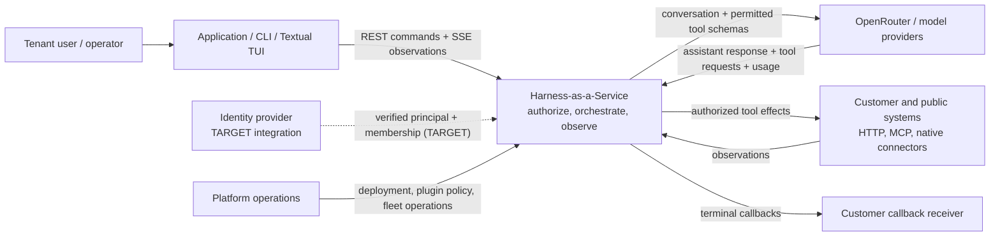
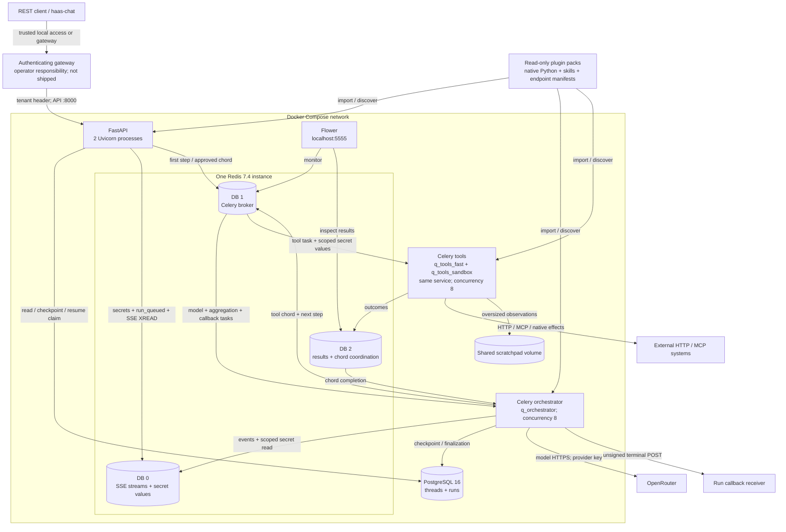
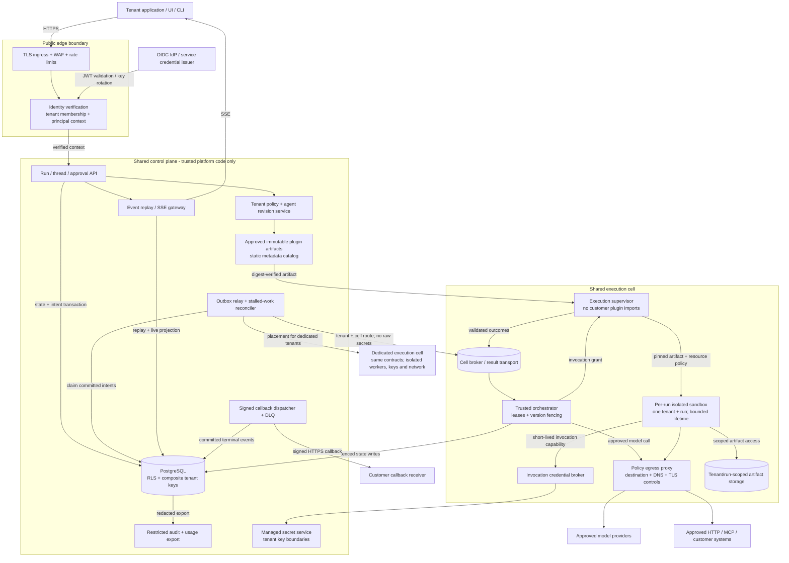
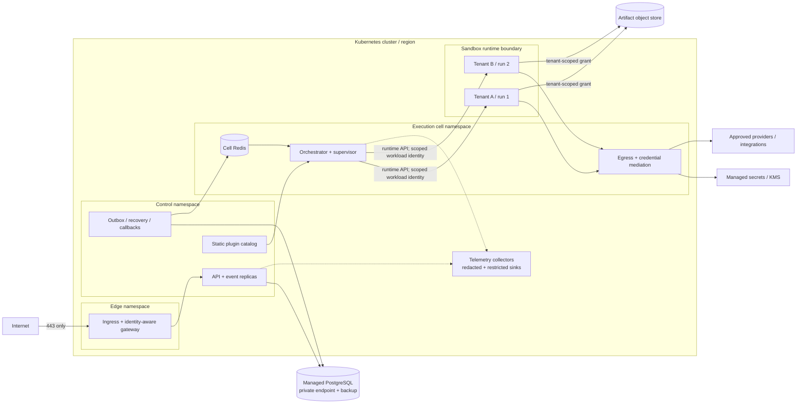

# Architecture diagrams

[Design index](README.md) | [SDD](sdd.md) | [DFD](data-flows.md) | [Threat model](threat-model.md)

## 1. System context (LOGICAL)

The provider receives prompts, history and included tool outputs, not merely a task
identifier. Provider selection and data residency are part of tenant policy in the target.

## 2. Implemented container architecture (CURRENT)

**Boundary qualifications:**

* Gateway is depicted as a required upstream responsibility, not an included service.
  The published API port is not inherently protected by it.
* Tool execution handlers run in tool workers, but Python plugin modules execute at
  import time in API and orchestrator processes too. All installed plugins must be trusted.
* Tool workers are not given the configured PostgreSQL DSN or OpenRouter key in
  Compose. This credential separation is not network enforcement: services share the
  Compose network, Redis credentials are not separated, and default settings exist.
* Redis DB numbers separate keyspaces, not principals, hosts or fault domains.
* `q_tools_sandbox` is routing metadata, not a separate sandbox.
* Native handlers can perform filesystem/network operations according to process
  privileges. URL validation applies only where handlers actually call it.
* All services use the same image. The plugin mount is read-only, but shared scratch
  content and Redis task/result content remain sensitive.

## 3. Production logical architecture (TARGET)

Arrow directions show requests/writes; replies use the same channel unless separately
drawn. Logical services may initially share a deployment only when identity/privilege
boundaries are preserved. This is not a requirement to create a microservice per box.

### Control-plane responsibilities

* Authenticate callers, resolve tenant membership, enforce RBAC and policy.
* Pin agent/model/plugin/policy revisions, reserve budgets, and persist accepted work.
* Store run, approval, invocation, event, usage and outbox records atomically.
* Route only committed work to the tenant's cell; reconcile incomplete dispatch.
* Serve redacted observations and signed deliveries without granting sandbox access
  to authoritative stores.

### Execution-plane responsibilities

* Verify execution envelopes and durable state, acquire leases and enforce epochs.
* Keep orchestration separate from native customer/plugin execution.
* Launch bounded per-run sandboxes from approved immutable artifacts.
* Mediate egress and credentials per invocation, collect outcomes and artifacts,
  terminate stale/cancelled work and report uncertain effects.
* Preserve tenant/cell identity through every queue, callback and artifact operation.

## 4. Deployment and network boundaries (TARGET)

Required policies are default-deny ingress/egress, no public database/broker/Flower,
service identities with short-lived credentials, restricted Kubernetes RBAC,
non-root/read-only sandbox root filesystems, no host paths, no privileged mode,
no cloud metadata access, resource limits and enforceable process termination.
Sandbox workloads must not inherit the supervisor's Kubernetes service-account token.

Managed services use TLS, independent identities, encryption and documented backup
and failover policies. Kubernetes scheduling alone does not establish tenant isolation;
enforcement must exist in runtime, network, identity and storage.

## 5. Placement, scaling and alternatives

* Start with one regional control plane and multiple execution cells. A tenant's
  cell/region assignment is durable and versioned; do not reroute in-flight work
  across cells without fencing the old epoch.
* Scale API by request/SSE capacity, orchestrators by queue age and provider capacity,
  and supervisors/sandboxes by reserved tenant concurrency.
* Preserve fair scheduling across tenants before priority within a tenant. Do not
  create unbounded per-tenant queues as the sole fairness mechanism.
* Dedicated cells isolate noisy neighbors and execution blast radius. Residency may
  require a dedicated regional control/data plane too.
* A workflow engine could replace part of Celery coordination if recovery requirements
  outgrow the lease/outbox design. It would not remove application-level authorization,
  effect idempotency, approval binding or sandbox requirements.

## 6. Product extensions (TARGET)

The following reuse the control/execution split above rather than adding new trust boundaries:

* **Marketplace registry** ([design](marketplace.md)) belongs to the control plane but stores
  only static metadata. Artifacts are pulled by digest by the execution supervisor and
  verified before sandbox launch. The review pipeline runs dynamic tests in an isolated
  analysis cell, never in a tenant cell.
* **Multi-agent runs** ([design](multi-agent.md)) are ordinary runs linked as a tree. Each node
  holds its own lease and sandbox and can be placed in any cell of the tenant's placement.
  Wake-ups are outbox messages.
* **Interop surfaces** (A2A, MCP server, OpenAI-compatible facade; [developer platform](developer-platform.md))
  are additional API front-ends behind the same edge identity verification and admission path.
