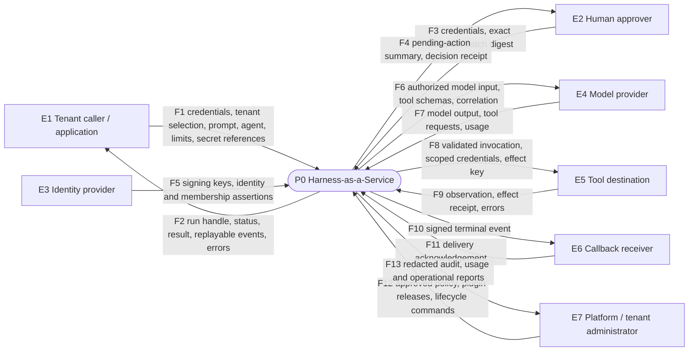
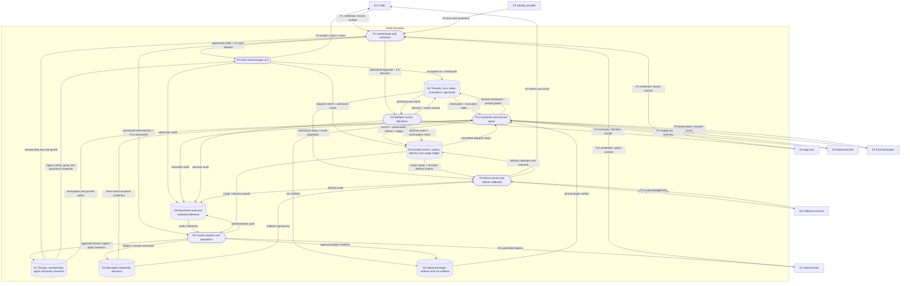
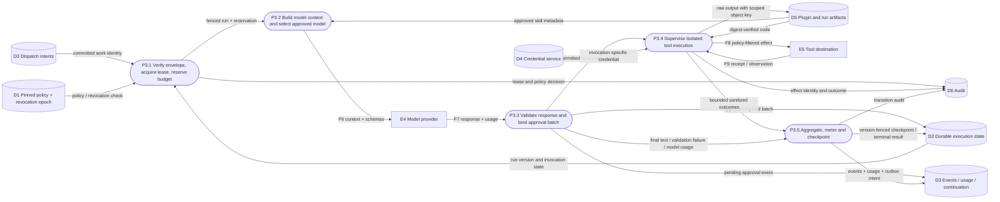
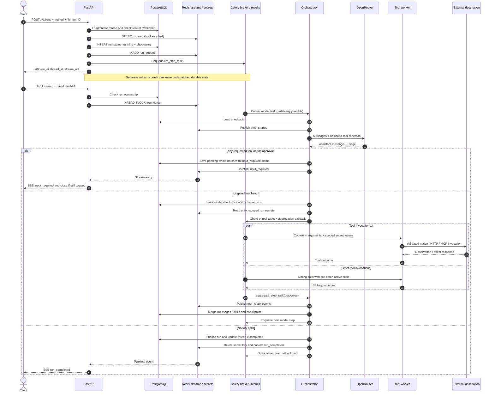
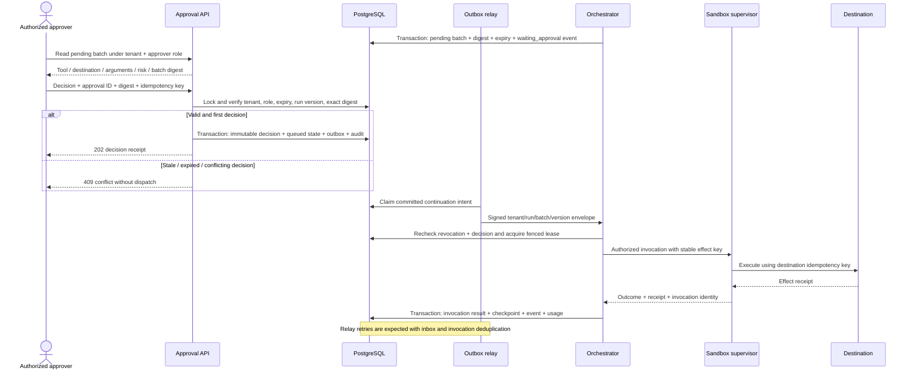

# Data-flow diagrams and execution sequences

[Design index](README.md) | [Architecture](architecture.md) | [Data model](data-model.md)

## 1. Notation and boundaries

* Rectangles represent external actors/systems; rounded nodes represent processes;
  cylinders represent stores.
* DFDs describe **data movement**, not scheduling order. Sequence diagrams below
  describe ordering, commits and failure windows.
* Level 0 and level 1 are the **TARGET** system. The current sequence is explicitly
  separate; it must not be read as implementing the target's controls.
* Trust boundaries: TB1 caller-to-edge; TB2 edge-to-control plane; TB3 control-to-execution;
  TB4 execution-to-sandbox; TB5 outbound integrations; TB6 stores/telemetry/operations.

## 2. DFD level 0: context (TARGET)

## 3. DFD level 1: service decomposition (TARGET)

### Balancing check

Every external level-0 flow survives decomposition:
F1/F2 → P1/P2/P5; F3/F4 → P1/P4; F5 → P1; F6-F9 → P3;
F10/F11 → P5; F12/F13 → P1/P6. D1-D6 are internal stores, not new external actors.
Large artifacts, secret values and audit payloads are not placed in public event streams.

## 4. DFD level 2: P3 agent execution (TARGET)

The state and event writes at P3.5 are one database transaction in the target.
P3.3 does not dispatch tools while approval is pending. Resumed work re-enters P3.1
with a committed decision and an exact batch version.

## 5. Create, execute and observe sequence (CURRENT)

Event order within aggregation is tool-result publication followed by its checkpoint.
Finalization and event publication are also separate operations. SSE is not an atomic
commit log of PostgreSQL and cannot repair missing publication.

## 6. Approval and safe continuation sequence (TARGET)

Rejection commits denial outcomes and a model continuation, not tool dispatch.
Approval expiry or run deadline produces an explicit failure; cancellation invalidates
the pending batch. A crash after remote success but before recording its receipt
requires a destination lookup by effect key or an `unknown` invocation for reconciliation.

## 7. Data classification along the flows

| Flow / store | Classification | Target handling |
|---|---|---|
| Prompt, thread, tool arguments and outputs | Tenant confidential; may contain regulated data | Tenant-aware access, provider policy, encryption, retention and redaction |
| Credential references | Sensitive metadata | Opaque references, authorization on dereference; no authority from knowing an ID |
| Secret values / signing keys | Restricted secrets | Secret service only; transient scoped use, never prompts, queues, logs or SSE |
| Approval summaries and decisions | Tenant confidential + security evidence | Exact digest, principal, timestamps and restricted audit |
| Events and callback payloads | Tenant confidential | Field allowlist, signed delivery, authenticated replay |
| Usage / identifiers / trace context | Operationally sensitive | Bounded cardinality, tenant authorization, no content in metrics labels |
| Plugin artifacts | Executable trusted or sandboxed code | Review, provenance, immutable digest and isolated import/execution |
| Raw artifacts / spilled output | Tenant confidential | Tenant/run-scoped grants, byte quota, expiry and deletion verification |
