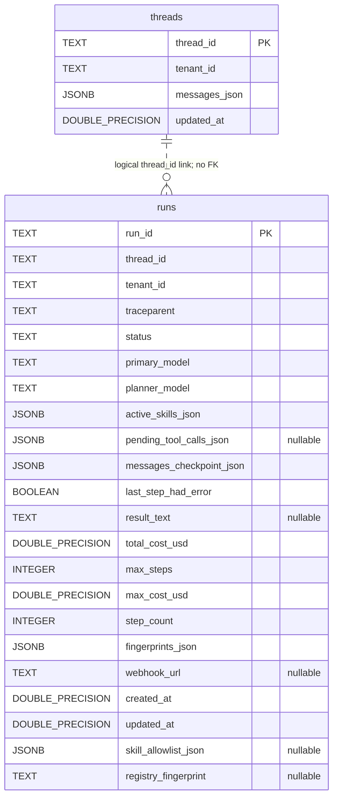
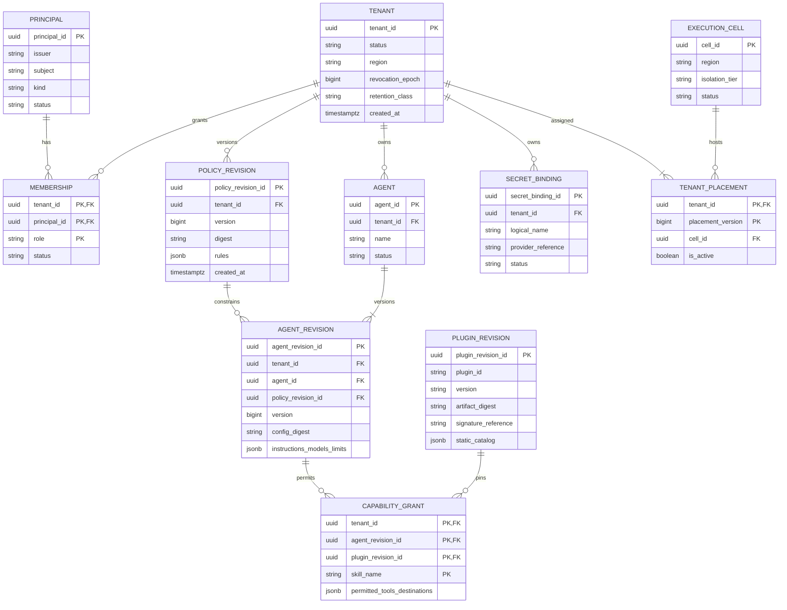
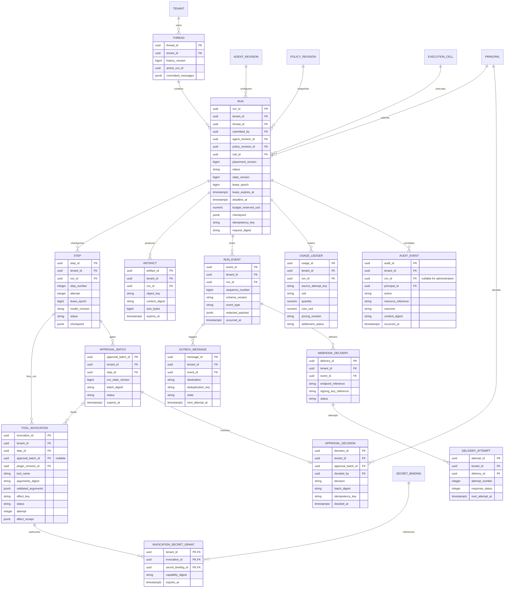

# Data model and entity-relationship diagrams

[Design index](README.md) | [SDD](sdd.md) | [Data flows](data-flows.md)

## 1. Physical relational model (CURRENT)

Authoritative DDL is [SCHEMA_SQL](../../app/core/store.py). There are exactly two
application tables. JSON arrays do not imply separate normalized entities.

The dashed relationship is logical only: the current database does **not** enforce a
foreign key between runs and threads or tenant equality across those records.
There is no tenants, users, approvals, events, invocations, artifacts or usage-ledger table.

### Current column semantics

| Fields | Constraints / meaning |
|---|---|
| IDs | Text primary keys; globally unique thread/run IDs, not composite tenant keys |
| `tenant_id`, `thread_id` on runs | Required text; ownership checked by application paths |
| `status` | Required free text; no database state enum/check constraint |
| `messages_json`, `messages_checkpoint_json` | Required JSONB, default empty array; full message snapshots |
| `active_skills_json`, `fingerprints_json` | Required JSONB arrays; stored fingerprint history limited to last 20 on checkpoint |
| `pending_tool_calls_json` | Nullable JSONB containing entire paused batch |
| `skill_allowlist_json` | Added by startup `ALTER`; NULL means unrestricted, empty array means no domain skills |
| `registry_fingerprint` | Added by startup `ALTER`; drift diagnostic, not a pinned artifact or signature |
| `total_cost_usd`, `max_cost_usd` | Double precision, defaults 0 and 0.30; not an exact monetary ledger |
| `max_steps`, `step_count` | Defaults 15 and 0; persisted step count can lag terminal reported step |
| `last_step_had_error` | Required boolean, default false |
| Timestamps | Double precision Unix seconds, set by application |
| Optional text | `result_text`, `webhook_url`, `registry_fingerprint` |
| Index | `runs_thread_idx(thread_id)`; no explicit tenant/status index or RLS |

Startup serializes schema creation with a PostgreSQL advisory transaction lock.
It is not a versioned migration framework. Finalization updates the run and, for
completion, thread history using separate statements without an explicit surrounding
transaction. Concurrent runs can overwrite whole thread histories.

## 2. Nonrelational state (CURRENT)

| Location / key | Shape / purpose | Lifetime / guarantee |
|---|---|---|
| Redis DB 0 `haas:secrets:{run_id}` | JSON dictionary of caller secret values | Default 3,600-second SETEX; re-supply replaces dictionary and resets TTL; cleared at finalization |
| Redis DB 0 `haas:stream:{run_id}` | Stream entries: `event_type`, `payload_json` | Approximate MAXLEN, default 1,000; expiry reset to 86,400 seconds on every publish |
| Redis DB 0 `haas:lock:{key}` | Generic NX lock helper | Default 15 seconds; helper exists but is not a general fenced run lease |
| Redis DB 1 Celery transport | Serialized JSON tasks / chord signatures | Redis visibility timeout 600 seconds; at-least-once/redelivery exposure |
| Redis DB 2 Celery result backend | Tool results, chord bookkeeping | Configured result expiry 3,600 seconds |
| Per-process registry | Plugins, schemas, skills, handlers, diagnostics | Startup snapshot; local fingerprint |
| Shared scratchpad volume | Oversized observations named from tool/call ID | No implemented tenant prefix, object authorization, expiry or cleanup policy |

Redis AOF is enabled in Compose. A value called "ephemeral" can still enter Redis
persistence, broker payloads, result metadata, monitoring or backups. Clearing one
secret key does not prove erasure of all copies.

## 3. Proposed tenancy and configuration ERD (TARGET)

These are logical entities for migration design, **not existing tables or executable
migrations**. All tenant-owned relationships below must include `tenant_id`.
Primary IDs are shown for readability; composite key requirements follow the diagrams.

`PRINCIPAL`, `PLUGIN_REVISION` and `EXECUTION_CELL` are global platform entities.
Tenant access to a plugin is conveyed by a grant, not by global catalog visibility.
Principal identity is unique on `(issuer, subject)`; a human may hold memberships in
multiple tenants. Service credentials map to principals with tenant-scoped grants.
Secret binding rows hold references only, never raw values.

## 4. Proposed execution and delivery ERD (TARGET)

An approval batch binds the entire proposed tool batch; invocation membership is
immutable after hashing. Multiple batches per step are allowed for future re-proposals,
but only one unresolved batch per active step is permitted. Rejection produces denial
outcomes rather than executing those invocations. An invocation can have multiple
attempts under the same effect identity; if detailed attempt history is needed, normalize
it into a child table rather than overwriting audit evidence.

### Required physical constraints

The target physical migration must implement these; diagrams alone do not enforce them:

1. Use a primary or unique key `(tenant_id, entity_id)` for each tenant-owned entity.
   A global UUID primary key may be retained only with this additional unique pair.
2. All tenant-owned child references are composite. For example,
   `RUN(tenant_id, thread_id)` references `THREAD(tenant_id, thread_id)`, and
   `TOOL_INVOCATION(tenant_id, step_id)` references `STEP(tenant_id, step_id)`.
   Apply the same rule to policy, agent, approval, artifact, event, delivery and secret links.
3. Principal references are checked against an active membership for that tenant at
   authorization time. Preserve past decision attribution when membership is revoked.
4. Unique `(tenant_id, run_id, step_number, attempt)` for step attempts;
   `(tenant_id, run_id, sequence_number)` for events; stable invocation/effect key;
   `(tenant_id, source_attempt_key, unit)` for ledger entries.
5. Unique `(tenant_id, submitted_by, operation, idempotency_key)` in a durable admission
   deduplication record (initial create operation may be materialized on RUN).
   Store request digest and response reference. Add a consumer inbox keyed by
   `(consumer, tenant_id, message_id)` to deduplicate outbox delivery.
6. Unique decision per approval batch; immutable batch digest and invocation membership.
   Different decisions with the same idempotency key conflict, not overwrite.
7. Unique active tenant placement and one active run per thread through partial unique
   indexes/transactional claims. `active_run_id` must match tenant **and thread**.
8. Validated state transitions and nonnegative numeric usage/reservation values.
   Use `NUMERIC`, not binary floating point, for settled monetary values.
9. Tenant-aware indexes starting with `tenant_id` for API list/read paths; dispatch
   indexes on pending outbox state and due time; retention indexes on expiry.
10. RLS on every tenant-owned table, including child, delivery, inbox, outbox and usage
    tables. Policy tests must exercise joins, writes, pooled connection reuse and maintenance.

UUIDs are not authorization. Target timestamps use `TIMESTAMPTZ`; identifiers,
trace IDs and provider request IDs are separate fields.

## 5. Checkpoint vs event vs audit

| Record | Authority / purpose | Mutability |
|---|---|---|
| Run checkpoint | Authoritative current execution state | Version-fenced update |
| Step/invocation | Durable dispatch and effect identity | State transitions with immutable inputs |
| Run event | Ordered user-visible state/observation | Append-only; redacted before persistence |
| Outbox/inbox | Delivery intent and consumer deduplication | Explicit delivery state |
| Usage ledger | Reservation, observation, settlement and adjustment | Append-only charges/adjustments, unique source key |
| Audit event | Who authorized/did what, to which tenant/resource | Append-only with integrity-protected export |
| Artifact | Large result not suitable for queue/message body | Immutable digest, controlled deletion |

The target is not automatically event sourcing: the checkpoint remains authoritative.
Durable events must be sufficient for observation/replay, not assumed sufficient to
reconstruct every provider response or secret.

## 6. Retention and deletion (TARGET policy defaults)

These proposed defaults require customer/legal approval before rollout:

| Data | Proposed baseline | Deletion / preservation rule |
|---|---|---|
| Raw secret value | Not stored in application DB/Redis; transient grant at most invocation lifetime | Revoke grants at completion/cancel; secret service manages authoritative lifecycle |
| Run/thread content and artifacts | 30 days after last completed activity | Tenant-configurable shorter retention; scoped deletion across all projections |
| Hot event projection | 24 hours | Durable replay tier remains available within authorized run retention |
| Delivery attempts | 30 days | Payload content follows run retention, even if delivery metadata retained |
| Security audit and metering metadata | 365 days | Minimize content; separate legal basis and tenant access rules |
| Admission/inbox dedupe | At least maximum task redelivery/replay horizon | Do not expire while old work can still replay |
| Backups | Proposed 35-day rolling encrypted window | Document delayed physical erasure and restore-time tombstone enforcement |

Tenant offboarding suspends new runs, revokes active credentials, fences execution,
exports allowed records, applies deletion/tombstones, removes projections/artifacts,
and records a deletion receipt. Legal holds must be explicit and visible to authorized
operators. Auditability is not a reason to keep raw secrets or unlimited prompts.
