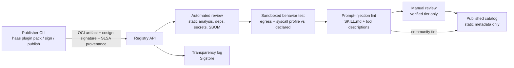
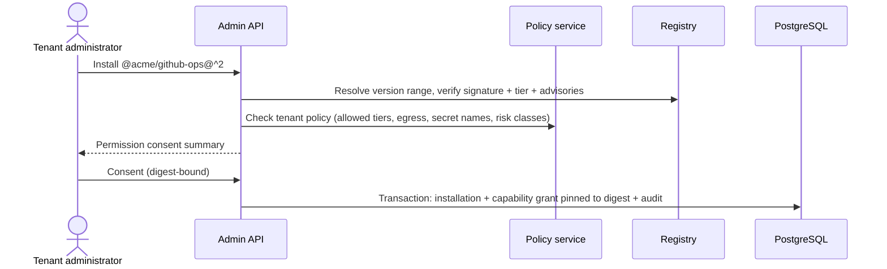

# Plugin marketplace design

[Design index](README.md) | [SDD](sdd.md) | [Threat model](threat-model.md) | [Data model](data-model.md) | [Roadmap](../roadmap.md)

**Status:** TARGET. Nothing in this document is implemented. The current system loads
operator-installed plugin packs from read-only mounts and imports native modules in the API,
orchestrator and tool workers ([plugin architecture](../plugin_architecture.md)). That model is
only safe for trusted code and is **incompatible** with third-party publishers until the
execution isolation controls in [SDD §4.3](sdd.md#43-execution-isolation) and roadmap Phase 4 pass
SEC-05, SEC-08 and SEC-09.

## 1. Goals and non-goals

Goals:

* An **open public marketplace** where verified and community publishers ship skills, tools,
  MCP servers and connectors that any tenant can discover and install under policy.
* **Private registries** per tenant or organization using the same API and artifact format.
* Compatibility with existing ecosystems: Agent Skills (`SKILL.md`), MCP servers (remote
  Streamable HTTP and packaged stdio), OpenClaw/ClawHub skill import, and OpenAPI-spec tool generation.
* Least privilege by construction: every plugin declares permissions; tenants consent to them;
  enforcement is outside model and plugin control.

Non-goals:

* Executing marketplace code in the control plane (API, orchestrator, relay, policy service).
* Agent-authored plugins that self-install at run time.
* Guaranteeing that a reviewed plugin is free of defects. Review reduces risk; sandboxing,
  egress mediation and per-invocation credentials bound the impact.

## 2. Concepts

| Concept | Definition |
|---|---|
| Publisher | Verified identity (person or organization) that owns a namespace `@publisher` |
| Listing | `@publisher/plugin` marketplace entry: description, categories, tier, ratings, advisories |
| Plugin revision | Immutable signed artifact `@publisher/plugin@semver` addressed by content digest |
| Permission manifest | Declared egress destinations, logical secret names, filesystem/workspace scope, sandbox profile, per-tool risk class |
| Trust tier | `platform`, `verified`, `community`, `private`, `unreviewed` — input to tenant policy |
| Installation | Tenant-scoped capability grant pinned to a plugin revision digest, with recorded consent |
| Registry | Public catalog or tenant/org-private catalog exposing the same API |
| Advisory | Security notice attached to revisions; may trigger yank and revocation |

## 3. Manifest v2

`plugin.json` gains a versioned schema (`manifest_version: 2`). Unknown keys remain errors.

```json
{
  "manifest_version": 2,
  "id": "@acme/github-ops",
  "version": "2.1.0",
  "api_version": "haas-plugin/1",
  "license": "Apache-2.0",
  "description": "Read and triage GitHub issues and pull requests.",
  "provides": {"skills": ["github-ops"], "tools": ["list_issues", "create_issue"]},
  "requires": {"plugins": {"@haas/core-http": "^1.0"}},
  "permissions": {
    "egress": ["https://api.github.com"],
    "secrets": ["GITHUB_TOKEN"],
    "workspace": {"read": ["/repo/**"], "write": []},
    "sandbox_profile": "network-restricted"
  },
  "tools": {
    "list_issues": {"risk": "read"},
    "create_issue": {"risk": "write", "approval": "required"}
  },
  "sbom": "sbom.spdx.json"
}
```

* `risk` is one of `read`, `write`, `destructive`, `financial`, `exfiltration-capable`.
  Tenant policy maps risk classes to approval requirements; a publisher can only make
  approval stricter, never waive it.
* Tool and skill names are local to the plugin. The catalog exposes them as
  `publisher.plugin.tool` to the platform and through a **per-run alias table** to the model,
  replacing the current global flat-name invariant (ADR-11).
* Version 1 manifests (current packs) are accepted for `platform` and `private` tiers and
  upgraded with `haas plugin migrate --v2`.

## 4. Supported formats

| Format | Ingestion | Execution |
|---|---|---|
| Agent Skills (`SKILL.md` + references) | Native | Instructions only; no code; lowest risk |
| Native Python tools | Built into an OCI artifact with locked dependencies | Per-run sandbox only |
| OpenAPI 3.x | Generator produces HTTP tool manifests (operations → tools, auth schemes → secret names, egress = servers) | HTTP adapter through egress proxy |
| Remote MCP server | Manifest pins server URL, protocol version and tool schema digests | Adapter through egress proxy; schema change → rug-pull block until re-consent |
| stdio MCP server | Packaged into the artifact with its runtime | Started inside the per-run sandbox |
| OpenClaw/ClawHub skills | Importer converts metadata to manifest v2, rejects binary/env gating that cannot be mapped, enters review as `unreviewed` | As converted format |

## 5. Publishing pipeline



* Artifacts are content-addressed OCI images; the control plane stores only extracted static
  metadata (manifest, JSON schemas, skill text) produced by the build, never by importing code.
* Signature and provenance are verified at publish, install **and** sandbox launch.
* An update that **expands permissions** is flagged; installations stay on the old revision
  until a tenant administrator re-consents.
* Yank stops new installs; a security advisory with revocation increments the affected tenants'
  revocation epoch, fencing in-flight runs that use the revision.

## 6. Installation and policy



Agent revisions reference installations; publishing an agent revision pins the exact plugin
digests (FR-14). Runs never resolve "latest".

## 7. Trust tiers and default tenant policy

| Tier | Review | Default availability | Execution constraints |
|---|---|---|---|
| `platform` | Platform-owned | Allowed | Sandbox; declared egress |
| `verified` | Automated + manual; verified publisher | Allowed after consent | Sandbox; declared egress |
| `community` | Automated only | Off until tenant enables tier | Sandbox; declared egress; write/destructive tools require approval |
| `private` | Tenant's own process | Tenant registry only | Sandbox; tenant-declared egress |
| `unreviewed` | None (e.g. fresh imports) | Development tenants only | Sandbox; no secrets; no egress except allowlisted test endpoints |

## 8. Registry API (TARGET, versioned under `/v1/registry`)

| Operation | Notes |
|---|---|
| `GET /listings?query=&category=&tier=` | Search with cursor pagination |
| `GET /listings/{ns}/{name}` / `.../versions` | Metadata, permissions, advisories, security report |
| `POST /publish` | Signed artifact + provenance; publisher scope required |
| `POST /listings/{ns}/{name}/versions/{v}/yank` | Publisher or platform |
| `GET /artifacts/{digest}` | Download by digest (supervisors, mirrors) |
| `POST /tenants/{t}/installations` | Admin; consent-bound |

## 9. Threats and acceptance

Threats TM-23 to TM-26 and TM-34 in the [threat model](threat-model.md); gates SEC-16 to SEC-19.
Key residual risk: a plugin that behaves within its declared permissions can still misuse data
it was legitimately granted. Mitigate with narrow permissions, approval classes and egress policy.
