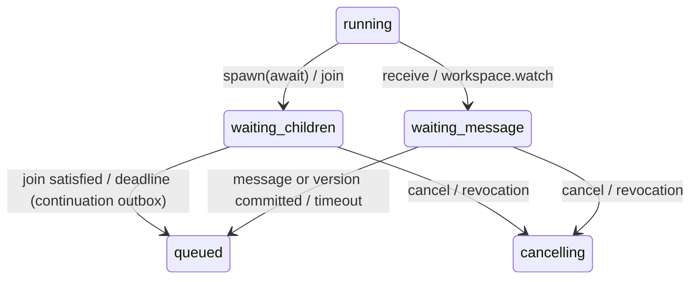

# Multi-agent collaboration design (HACP)

[Design index](README.md) | [SDD](sdd.md) | [Threat model](threat-model.md) | [Data model](data-model.md) | [Roadmap](../roadmap.md)

**Status:** TARGET. The current system is a single-agent run harness; parallel tool calls are not
sub-agents. This document defines the **HaaS Agent Collaboration Protocol (HACP)** and its
interoperability surfaces (A2A, MCP server, OpenAI-compatible facade). It depends on roadmap
Phase 2 (agent revisions), Phase 3 (outbox, leases, cancellation, ledger) and Phase 4 (sandbox,
artifact service).

## 1. Positioning

LangChain *deepagents* combine a planning tool, a virtual filesystem, a `task` sub-agent tool and
human-in-the-loop interrupts inside one LangGraph process. HACP keeps those ergonomics and makes
each one **durable, distributed and policy-enforced**:

| deepagents / LangGraph concept | HACP equivalent |
|---|---|
| `write_todos` planning tool | Persisted plan on the run, visible in events and the run tree |
| Virtual filesystem in graph state | Versioned, tenant-scoped **workspace** (artifact service) with per-agent path scopes and compare-and-set |
| `task` tool spawning a sub-agent in-process | **Child run** with its own lease, sandbox, cell placement and budget slice; runs in parallel on any worker |
| Graph state checkpointer | PostgreSQL checkpoints with version fencing; crash recovery by lease expiry |
| `interrupt()` | Approval batches; descendant approvals surface on the root run |
| Sub-agent tool lists | **Attenuated delegation**: child grants are a subset of the parent's |
| Graph edges | Declarative topology in the agent revision, validated at publish |

## 2. Primitives

Exposed to models as built-in tools (always policy-checked) and to developers via REST/SDK.

| Primitive | Semantics |
|---|---|
| `write_todos(items)` | Replace the run's plan; emits `agent.plan.updated` |
| `spawn_agent(agent, input, caveats, mode)` | Create a child run of a permitted agent revision. `mode=await` pauses the parent in `waiting_children`; `mode=async` returns a handle |
| `handoff(agent, input)` | Transfer control; the current run completes with a `handoff` result and the successor becomes the active run of the thread |
| `send_message(to, body)` / `receive(timeout)` | Mailbox messaging between agents in the same run tree; `receive` pauses in `waiting_message` without holding a worker |
| `workspace.read/list/write/edit/cas/watch` | Versioned entries under path scopes; `cas` requires the expected version; `watch` resumes on change |
| `join(handles, policy, timeout)` | `all`, `any`, `quorum(n)`; resumes when satisfied or on deadline |
| `cancel_agent(handle)` | Fenced cancellation of a descendant subtree |

Waiting never holds a Celery worker. Wake-ups are outbox messages created in the same transaction
that changes the child's state, writes the message or commits the workspace version.

## 3. Lifecycle additions



## 4. Message envelope

```json
{
  "schema_version": "hacp/1",
  "message_id": "opaque",
  "tenant_id": "opaque",
  "root_run_id": "opaque",
  "from_run_id": "opaque",
  "to_run_id": "opaque",
  "delegation_id": "opaque",
  "kind": "message | result | handoff | cancel",
  "body_reference": "artifact or inline redacted JSON",
  "sent_at": "2026-10-17T16:30:00Z"
}
```

Bodies are untrusted data to the receiving model, labelled with provenance. They never carry
credentials or grants.

## 5. Delegation, attenuation and budgets

* A **delegation** records the parent run, child run, caveats and a budget slice. Caveats are
  expressed as an attenuable token (Biscuit/macaroon style) over: agent revisions spawnable,
  tools, secret logical names, egress destinations, workspace paths (read/write), maximum depth,
  maximum fan-out, deadline and budget.
* Enforcement happens in the orchestrator and execution supervisor against durable state.
  `child ⊆ parent` is checked on every spawn; prompt text cannot widen it (ADR-08).
* The budget ledger reserves the child's slice from the parent's reservation. Unused budget returns
  on settlement. Tenant-level depth, fan-out and total-descendant limits bound spawn storms.

## 6. Topologies

Agent revisions may declare a topology validated at publish time:

| Topology | Description |
|---|---|
| `single` | Today's behavior |
| `supervisor` | One coordinator spawns permitted workers |
| `hierarchical` | Supervisors of supervisors with depth limit |
| `swarm` | Peers hand off control via `handoff` |
| `graph` | Persisted DAG/cyclic graph with conditional edges (LangGraph-like); cycles need step caps |
| `map_reduce` | Fan out over inputs, `join(all)`, reduce |
| `debate` | Proposers + reviewer/judge with round limit |

## 7. Human-in-the-loop, cancellation and failures

* Any descendant's `waiting_approval` batch is listed under the root run with its lineage;
  approver RBAC is evaluated against the tenant, not the child.
* Cancelling or suspending any node cascades to its subtree; revocation epochs fence all of it.
* Failure policies per spawn: `fail_fast`, `best_effort`, `retry(n)`, `escalate` (return failure as
  an observation to the parent).

## 8. Interoperability

| Surface | Direction | Notes |
|---|---|---|
| A2A server | Inbound | Agent Card per published agent revision; tasks, messages, streaming; OIDC/API-key auth; maps to runs |
| A2A client tool | Outbound | Calls remote agents through the egress proxy; destination policy and approval classes apply |
| MCP server | Inbound | Tenant MCP endpoint (Streamable HTTP, OAuth) exposing published agents as tools |
| OpenAI-compatible facade | Inbound | `/v1/chat/completions` and Responses API mapped to agent revisions; approvals/tools surfaced as events; same policy |

## 9. Observability

`GET /v1/runs/{id}/tree` returns the run graph with status, cost and lineage; the root stream
can aggregate descendant events (`agent.spawned`, `agent.message`, `workspace.updated`,
`agent.joined`). Traces link across delegations.

## 10. Threats and acceptance

Threats TM-27 to TM-31 in the [threat model](threat-model.md); gates SEC-20 to SEC-22 and SEC-25.
