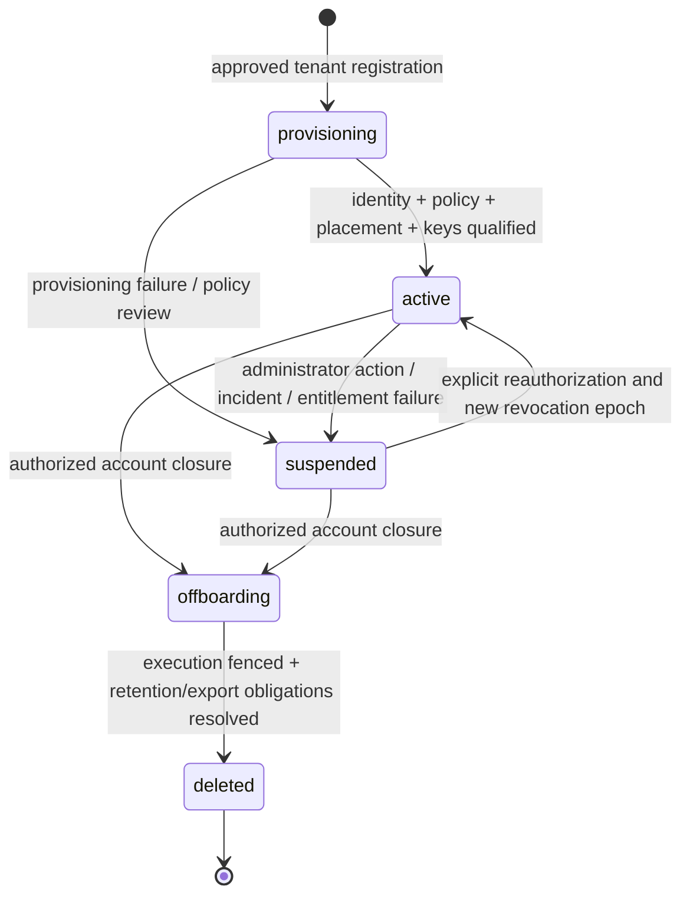
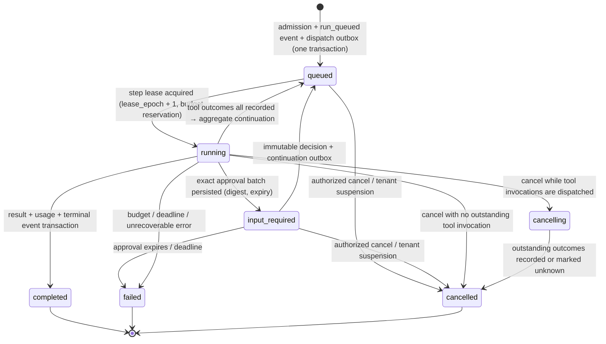
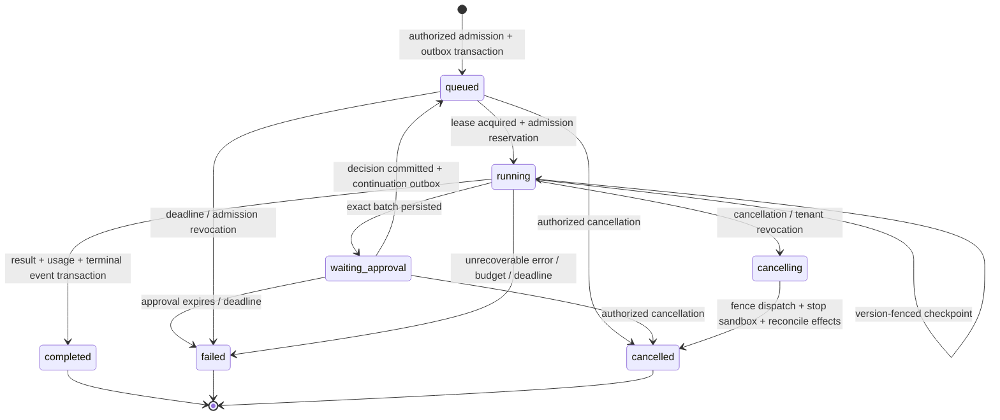

# Software design description

[Design index](README.md) | [Architecture](architecture.md) | [DFD](data-flows.md) | [ERD](data-model.md)

## 1. Purpose, scope and terminology

HaaS separates the durable orchestration of agent work from its model and tool
execution. Applications submit work rather than owning a long-lived agent process.
The service owns lifecycle, capability policy, checkpointing, event delivery, approval
coordination and metering.

This SDD describes both the implemented baseline and the required production
extension. It does not add runtime functionality.

| Term | Definition |
|---|---|
| Tenant | Customer security, policy, billing and retention boundary |
| Principal | Authenticated human or service identity; absent as a persisted current entity |
| Thread | Conversation history reused across sequential runs |
| Run | One bounded agent execution against a thread |
| Step | One model invocation and its optional batch of tools |
| Skill | Instructions, references, tool requirements and allowed-secret declarations |
| Tool invocation | One validated request to a native handler or remote endpoint |
| Plugin revision | Versioned capability pack; currently local files plus a registry fingerprint |
| Approval | Authorization to dispatch an exact pending batch, not permission to change policy |
| Execution cell | Target fault/isolation domain containing workers, broker access and sandbox capacity |
| Agent definition | Target immutable configuration of instructions, models, skills and limits |

### Scope

* CURRENT: REST, SSE, thread history, planner/primary model routing, skills/plugins,
  Celery tool fan-out/join, approval pause/resume, checkpoints, cost observations,
  callback retries, CLI/TUI.
* TARGET: verified identity and membership, RBAC, tenant administration, immutable agent
  versions and policy snapshots, per-run sandboxes, credential references, durable event
  and dispatch outbox, idempotent recovery, quotas, auditing and retention.
* TARGET (product extensions): an open plugin marketplace with private registries
  ([marketplace](marketplace.md)), the HaaS Agent Collaboration Protocol for distributed
  multi-agent work with A2A/MCP/OpenAI-compatible interoperability ([multi-agent](multi-agent.md)),
  and a contract-first developer platform with SDKs and CLI ([developer platform](developer-platform.md)).
  A first-class [terminal workbench](tui-experience.md) delivers these user-facing
  capabilities incrementally, with role-aware journeys and terminal UX acceptance gates.
  Delivery order is in the [roadmap](../roadmap.md).
* NON-GOALS for this design: arbitrary customer or marketplace code in the control plane
  (API, orchestrator, relay, policy) — such code runs only in qualified per-run sandboxes;
  agent-authored plugins installed at run time; model training; and exactly-once
  side effects without cooperation from destination systems.

## 2. Functional requirements and traceability

| ID | Requirement | Current evidence / gap | Target verification |
|---|---|---|---|
| FR-01 | Accept bounded asynchronous work and return a run handle | `POST /v1/runs`, 202 | Idempotent admission test |
| FR-02 | Authorize every resource operation within an authenticated tenant | Verified OIDC/API keys, RBAC, composite ownership constraints and transaction-scoped forced RLS; artifact isolation remains later work | Membership, role and cross-tenant negative tests |
| FR-03 | Preserve thread history without concurrent overwrite | Atomic thread claim/version checks and completion, scoped history/branch APIs | Thread version/active-run conflict tests |
| FR-04 | Expose only permitted, ready skills/tools | Tenant/run skill lists and worker unlock checks | Revocation, policy and worker enforcement tests |
| FR-05 | Execute an explicit, recoverable run lifecycle | Checkpoints; general updates not version-fenced | Crash/replay and lease-fencing tests |
| FR-06 | Pause side-effecting batches for authorized human decisions | `input_required`, atomic resume claim | Exact-batch digest, expiry and approver-role tests |
| FR-07 | Bound compute, model usage, tool calls and artifacts | Steps, observed cost, timeout and output truncation partially cover this | Concurrent reservations, deadline and kill tests |
| FR-08 | Deliver ordered, resumable run observations | Redis stream cursor within finite retention | Durable replay, gap detection and auth renewal tests |
| FR-09 | Integrate native, HTTP and MCP capabilities | Plugin registry adapters | Destination/auth/schema contract tests |
| FR-10 | Minimize secret exposure | Run Redis value; union of active-skill secrets copied to task | Invocation-specific credential broker tests |
| FR-11 | Deliver terminal callbacks reliably and verifiably | Unsigned callback task with retries | Signed delivery, replay protection, DLQ and replay tests |
| FR-12 | Meter usage per tenant and export an audit trail | NUMERIC cost after Phase 2 cutover and append-only actor-scoped audit; no usage ledger yet | Unique ledger charges and immutable audit tests |
| FR-13 | Cancel work and enforce tenant suspension | Cooperative cancel endpoint; no fenced suspension/cascade | Fenced cancellation and revocation tests |
| FR-14 | Select approved agent configuration reproducibly | Immutable draft/validated/published agent configuration, pinned policy and registry fingerprint; signed plugin artifacts remain P4 | Agent/policy/plugin revision pinning tests |
| FR-15 | Publish signed, versioned plugin revisions with declared permissions | Local packs, no signing or permission manifest | Signature/provenance and manifest validation tests (SEC-16) |
| FR-16 | Let tenants discover and install marketplace plugins under consent and tier policy | Operator allow/deny env only | Consent, tier and re-consent-on-expansion tests (SEC-18) |
| FR-17 | Revoke or yank plugin revisions and fence affected work | Restart-based reload | Yank/advisory revocation fencing tests (SEC-19) |
| FR-18 | Import Agent Skills, ClawHub skills, OpenAPI specs and MCP servers as plugins | Agent Skills + HTTP/MCP manifests | Adapter contract and rug-pull detection tests |
| FR-19 | Spawn, join, message and hand off between agents as durable child runs | Single-agent loop | Run-tree crash/recovery and join semantics tests |
| FR-20 | Delegate only attenuated capabilities and budget slices to child agents | Not applicable | Delegation attenuation and budget-tree tests (SEC-20, SEC-21) |
| FR-21 | Share a versioned, scoped workspace between agents in a run tree | Shared scratch volume, no scoping | Path-scope, CAS and isolation tests (SEC-22) |
| FR-22 | Interoperate via A2A, MCP server and an OpenAI-compatible facade with policy parity | Not present | Authn/authz matrix and facade parity tests (SEC-23, SEC-24) |
| FR-23 | Provide a versioned machine-readable contract for API, events and webhooks | FastAPI-generated OpenAPI only | Spectral lint, breaking-change diff, schema conformance tests |
| FR-24 | Provide Python and TypeScript SDKs and a unified CLI with safe defaults | Internal Python client, TUI, `haas-plugin` | SDK conformance suite against mock server; credential hygiene (SEC-26) |
| FR-25 | Deliver user-facing platform capabilities through a keyboard-first, authorized, recoverable terminal workbench alongside backend milestones | T0/T1 workbench plus command-driven T2 agent/history/branch journeys and capability metadata; durable inspection and later-phase journeys remain targets | Track T journey parity, auth/recovery, safe rendering, terminal/accessibility, performance and compatibility gates (TUI-01..07) |

Proposed availability, latency, recovery and retention objectives are specified in
[operations](operations-migration.md). They are acceptance targets, not measured results.

## 3. Current component design

| Component | Responsibility | State / privileges |
|---|---|---|
| FastAPI API | Discover registry, validate requests, establish thread ownership, create runs, claim resume, serve status/events | PostgreSQL + Redis; imports native plugin modules |
| Orchestrator worker | Call model, checkpoint, gate batches, dispatch tools, aggregate, finalize and schedule callbacks | PostgreSQL + Redis + OpenRouter key; imports plugin modules |
| Tool worker | Validate arguments, enforce unlock policy, construct `RunContext`, invoke handler, return outcome | Redis broker/backend, scoped task secrets, scratchpad; no configured production DB credential or model key in Compose |
| Plugin registry | Deterministic discovery, dependency order, readiness, schemas, references, allowlists, fingerprint | Per-process in-memory registry loaded at startup |
| PostgreSQL | Thread history and run checkpoints | Authoritative run status, not a complete workflow/event ledger |
| Redis | Broker, chord results, SSE streams, secret values | Logical DBs 0/1/2 in one instance; not independent security boundaries |
| Client/TUI | Submit, observe, reconnect, approve/reject, reuse thread | Holds user-provided secrets in client memory |
| Flower | Celery operational UI | Broker/backend access; local binding, optional basic auth |

The Docker image runs as UID 10001. Tool workers have dropped capabilities, a
read-only root filesystem, tmpfs and shared scratch volume. Those are useful baseline
hardening controls, but do not isolate tenants from each other or constrain Python
module import-time behavior.

## 4. Production tenancy design (TARGET)

### 4.1 Identity and authorization

1. Gateway validates OIDC access tokens or tenant-scoped service credentials:
   signature, issuer, audience, expiry, revocation and selected tenant membership.
2. Strip any client-supplied internal identity headers. A tenant selection header is
   only a selector, never proof of membership. Reject absent/ambiguous tenant selection;
   production must not silently fall back to `default-tenant`.
3. API validates trusted identity via a verifiable token or authenticated internal
   gateway channel; internal routes are inaccessible from the public network.
4. Authorization evaluates **principal + tenant + action + resource + policy version**.
   Tenant configuration is deny-by-default, including model providers, destinations,
   plugin revisions, maximum budgets and retention class.
5. Copy immutable tenant/run/policy/cell identity into durable work records and a
   signed, short-lived execution envelope. Workers verify and compare it with durable state.
6. Admission success does not permanently authorize execution: workers recheck
   tenant suspension, revocation epoch, approval validity and run lease before effects.

| Role | Allowed responsibilities (TARGET) |
|---|---|
| Tenant administrator | Membership, agent/plugin/model grants, destinations and quota policy |
| Run submitter / service principal | Create and read authorized runs; cancel within granted scope |
| Approver | View sensitive pending-action summary and approve/reject permitted risk classes |
| Auditor | Read redacted audit/usage records; no execution or secret-value access |
| Platform operator | Fleet/cell operations; no implicit customer content access |
| Break-glass operator | Time-limited, separately approved content access, fully audited |

Roles may be scoped to project/agent later; project hierarchy is not required for
the initial target. Deny self-approval for configured high-risk actions. An approver
cannot expand skill policy, replace a tool's arguments or authorize a different tenant.

The initial `/v1` action policy permits tenant administrators and submitters to create,
read, stream and cancel tenant runs. Approvers can read only a pending approval summary
and approve/reject it; they cannot stream run events or decide their own submission.
Auditors have no run-content access, operators receive no implicit customer-content
access, and a `break_glass` membership alone grants nothing without a separate
time-limited approval. Unknown roles and actions are denied. Development-only
header-tenancy remains an explicit bypass for local compatibility.

The Phase 1 policy slice stores digest-verified immutable tenant policy revisions and
pins each authenticated run to its active revision. Admission requires an explicit
OpenRouter provider and exact model grant, caps requested budgets, checks webhook
destinations against exact normalized host grants, and resolves plugin skills only when
the installed plugin digest matches the tenant grant. The development header path retains
the legacy environment skill allowlist. Policy authoring/admin APIs and authenticated
approval-decision audit are implemented. Worker-time policy revalidation and mediated
egress remain later-phase controls; a `break_glass` membership is deliberately actionless
until a separately approved, time-limited workflow exists.

### 4.2 Data isolation

Shared PostgreSQL uses `tenant_id` on every tenant-owned row and composite
tenant-aware foreign keys. RLS is enforced using a non-owner application role
without `BYPASSRLS`, with transaction-local tenant context, `USING` and `WITH CHECK`
policies, and forced RLS where appropriate. Never leave tenant context on pooled
connections. Cross-tenant dispatch/maintenance uses explicit, narrowly privileged
service paths, not a public API role that bypasses all policies.

Redis, artifact keys, caches and logs include tenant and cell identity; naming is
not access control. Use broker credentials/ACLs and trusted mediators. Sandboxes
receive neither shared Redis credentials nor PostgreSQL credentials.

### 4.3 Execution isolation

* Shared admission and policy services can serve many tenants.
* Trusted orchestrators coordinate runs but do not import tenant-controlled Python.
* A tool execution supervisor starts a per-run sandbox with bounded CPU, memory,
  PIDs, filesystem and lifetime. Per-invocation capability grants restrict each tool.
* A sandbox is scoped to one tenant/run. It cannot consume arbitrary broker work,
  mount another run's artifacts, access metadata services, or reach internal stores.
* Use sandboxed runtimes/microVMs for untrusted native code; a Kubernetes namespace
  or a queue name alone is insufficient. Select the runtime during infrastructure
  qualification; do not claim ordinary containers defeat a hostile kernel exploit.
* Higher-assurance tenants receive dedicated cells with separate worker identity,
  broker/store access, keys and network policy. A dedicated cell still has shared
  control-plane dependencies; sell full-stack dedication only if those are also separated.

### 4.4 Tenant and agent lifecycle

**TARGET:** provisioning allocates tenant identity, initial administrator membership,
region/cell assignment, quota, key/secret namespace and deny-by-default policy.
Activate only after those dependencies are verified. Suspension denies new admission,
revokes credentials and grants, advances the revocation epoch, fences ongoing execution
and restricts reads according to incident policy. Re-activation requires explicit
reauthorization, advances the epoch, and invalidates credentials issued before the
reactivation time; it never resurrects stale approvals or work envelopes. Deletion
requires execution fencing and resolved retention/export obligations.
Offboarding follows the [deletion procedure](data-model.md#6-retention-and-deletion-target-policy-defaults).

An agent definition moves through draft, validation and publication. Publication
creates an immutable revision binding instructions, model policy, plugin digests,
skill/tool grants, destinations and budgets. Runs select a published revision;
editing a draft cannot alter an admitted run. Deprecation prevents new admission,
while emergency revocation also stops affected in-flight work through policy epochs.

## 5. Agent execution layer

### 5.1 Current lifecycle (Phase 3)

PostgreSQL is the workflow authority. Every transition is a compare-and-set on
`(run_id, state_version, lease_epoch)` that commits its `run_events` rows and `outbox`
intents in the same transaction; a relay (`SELECT … FOR UPDATE SKIP LOCKED`) publishes
those intents to Celery after commit, and consumers deduplicate deliveries through
`consumer_inbox`. Celery and Redis therefore carry only redeliverable messages. Client
detachment does not cancel execution; `input_required` is a pause, not completion.

1. Admission resolves the tenant skill list/narrowing, validates preload and callback,
   claims thread ownership and (optionally) an `Idempotency-Key` with a request digest,
   then writes the run as `queued` with its deadline and budgets atomically.
2. Caller secrets are stored separately in encrypted Redis before admission commits.
3. An orchestrator delivery acquires the step lease (new `lease_epoch`), records a
   `run_steps` attempt and reserves the conservative model cost in `usage_ledger`
   before calling the model. Stale leases cannot write: every write is fenced.
4. Planner/primary selection is unchanged (planner on step 1 or after a tool error).
5. No tool calls completes the run. Otherwise each call becomes a `tool_invocations`
   row with an `arguments_digest` and stable `effect_key`. Approval-required batches
   persist an `approval_batches` row and pause; others are dispatched under signed,
   expiring Ed25519 execution envelopes that tool workers verify with a public key only.
6. Tool workers record outcomes through the fenced invocation record, independent of
   the Celery result backend. The last outcome queues the aggregate continuation.
7. Completion updates run and thread history, settles usage, clears secrets, emits the
   terminal event and schedules an optional callback in one transaction + outbox.
8. A separate maintenance service relays the outbox and runs the reconciler: expired
   leases are requeued with a `run_recovering` event and new epoch (bounded attempts),
   dispatched invocations without outcomes become `unknown` after
   `TOOL_OUTCOME_TIMEOUT_SEC`, approvals and deadlines expire, and stale inbox rows
   are pruned. Unknown effects are never silently re-executed.

### 5.2 Current limits and semantics

* Step cap: default 15; API range 1-50, checked before each step lease.
* Cost cap: default USD 0.30; API range greater than zero through USD 10. Each model
  step reserves a conservative cost from `MODEL_PRICING_JSON` before dispatch and is
  refused if spent + reserved + estimate would exceed the cap; observed cost is settled
  per attempt and enforced after every step, including final-text responses. Models
  without configured pricing reserve zero, so the post-step check is the only guard.
  Reservations of abandoned attempts become `uncertain` and count as spent, so a lost
  model response can never silently free budget.
* Deadline (`deadline_sec`, default `DEFAULT_RUN_DEADLINE_SEC`) and tool-invocation
  count (`max_tool_invocations`) are enforced durably. Artifact-byte and egress quotas
  arrive with the Phase 4 artifact service and egress proxy.
* Tool timeout: default 25 seconds. Sync handlers use `asyncio.to_thread`; timeout
  is not proof the underlying thread/effect was stopped.
* Tool output: default 4,000-character observation bound; larger raw output is spilled
  to the shared scratch volume. This is not a tenant-aware artifact service.
* Repeated-call guard: a third consecutive identical fingerprint under defaults
  changes the observation **after execution**. It neither prevents that effect
  nor guarantees eventual termination independently of the step cap.
* Secret scope: union of allowed secrets for effective active skills, not a separate
  credential set per individual tool. Decision-provided secrets replace the dictionary.
* Approval: any approval-required tool pauses **all** calls from that response as one
  batch with a digest over the exact calls. Decisions are immutable, attributed,
  separation-of-duties checked, expire, and exactly one concurrent decision wins.
* Delivery is at least once; downstream exactly-once effects require destinations to
  honour the `effect_key`. Models/tools remain nondeterministic.

### 5.3 Target lifecycle and concurrency

Recoverable worker loss does not create a new business run: expire the lease, reconcile
the current step/invocations, and requeue with a new fencing epoch. Unknown external
effects are marked `unknown` on their invocation, never silently repeated.

**Target invariants:**

1. At most one unfenced orchestration lease mutates a run; every transition uses
   `(tenant_id, run_id, state_version, lease_epoch)` compare-and-set.
2. At most one nonterminal run owns a thread by default. A concurrent create returns
   409; explicit branching creates a new thread with a recorded parent/version.
3. State changes, usage records, approval records, audit references and outbox intents
   commit atomically where they share the same database.
4. A delivery may occur multiple times. An inbox/deduplication key and durable invocation
   record ensure only the current authorized attempt is executed.
5. Admission idempotency is scoped to tenant + principal + operation + key with request
   digest comparison. Same key with different body returns 409.
6. Finalization cannot be overwritten by a stale callback, retried task or tool result.
7. Cancellation blocks new work immediately; completed or uncertain remote effects
   require reconciliation/compensation rather than an exactly-once promise.
8. Plugins, agent configuration, policy and approval batch hashes are pinned. Revocation
   may further restrict a run, never silently broaden it.

### 5.4 Target budget algorithm

Reserve tenant concurrency and maximum permitted step spend before dispatch. Calculate
conservative model cost from approved model pricing, bounded output tokens and input
size. Reconcile the reservation against observed usage in a unique per-attempt ledger;
missing/uncertain usage blocks additional spend or triggers operator reconciliation.
Apply a wall-clock deadline, tool invocation count, artifact-byte and egress quotas.
Third-party billing may still overshoot due to pricing changes or uncertain responses;
report that exposure explicitly. Tool-side monetary limits belong in destination policy
and approval as well as in the model budget.

## 6. Interfaces, persistence and errors

The [integration guide](integrations-usage.md) is the current API contract; target
contracts are separately labeled. The [ERD](data-model.md) defines current physical
storage and target relationships.

| Condition | CURRENT behavior | TARGET behavior |
|---|---|---|
| Invalid body / skill narrowing / unsafe callback | 422 | Typed validation error, no admission |
| Foreign or absent run/thread | 404 | Same, after verified identity |
| Resume not paused / already decided / stale digest | 409 | Same |
| Invalid tool arguments / domain failure | Tool error observation; planner on next step | Structured sanitized failure with risk-aware retry policy |
| Retryable model HTTP failure | Up to two task retries with backoff | Bounded retry + jitter + circuit breaker + usage reconciliation |
| Callback exhausts retries | Logged permanent failure | Persisted delivery failure, DLQ, operator replay |
| Broker fails after DB checkpoint | Outbox row stays pending; relay retries and the reconciler requeues stalled leases | Same, with alerting on relay lag |
| Worker lost mid-step / mid-tool | Lease expiry → `run_recovering` + new epoch; undispatched outcomes → `unknown` | Same plus sandbox teardown (Phase 4) |
| Registry drift | Warn and emit flag; continue | Execute pinned revision or block with explicit incompatibility |

Avoid exposing provider responses, tokens, raw exception strings, prompts and tool
arguments in general logs. Public errors use stable codes, safe summaries and
correlation IDs; restricted diagnostic records preserve actionable internal detail.

## 7. Design decisions

| ID | Decision | Reason / trade-off |
|---|---|---|
| ADR-01 | Retain FastAPI, Celery and PostgreSQL as the initial production foundation | Build on working components; add workflow correctness rather than an immediate engine rewrite |
| ADR-02 | PostgreSQL is the authority; outbox drives Redis-backed delivery | Reduces DB/broker dual-write gaps; requires dispatch/reconciliation services |
| ADR-03 | Shared tenant-aware control plane with optional dedicated cells | Cost-efficient default; high-assurance isolation has explicit operational cost |
| ADR-04 | Per-run sandbox, per-invocation capabilities | Limits credential/data exposure; sandbox startup and cleanup overhead |
| ADR-05 | Immutable agent/plugin/policy revisions and revocation epochs | Reproducibility and auditability without ignoring emergency revocation |
| ADR-06 | At-least-once transport with deduplicated effects where supported | Honest distributed semantics; unsupported destinations need manual reconciliation |
| ADR-07 | SSE is an observation interface, never the workflow coordinator | Client disconnect/reconnect must not own execution liveness |
| ADR-08 | Separate authorization from prompt instructions | Prompt injection must not expand permissions |
| ADR-09 | Keep Celery as task transport; workflow correctness lives in PostgreSQL (outbox, leases, fencing) | Avoids an engine migration; multi-agent waits are outbox-driven, never cross-agent chords. Revisit if reconciler complexity grows |
| ADR-10 | Open marketplace code executes only in per-run sandboxes; control plane consumes build-time static metadata | Enables third-party publishers without TM-04 exposure; requires a build/extraction pipeline |
| ADR-11 | Namespace plugins (`@publisher/plugin`) and expose tools to models through per-run aliases | Replaces globally unique flat names; requires alias mapping in history and events |
| ADR-12 | Sub-agents are child runs with attenuated delegation tokens and budget slices | Reuses durable run machinery; adds run-tree state and wake-up outbox messages |

## 8. Compatibility and acceptance

Keep current `/v1` response shapes and event names during initial hardening where
safe. Authentication is an intentional breaking deployment requirement: allow the
legacy header-only mode only on an explicit development profile, never as a production
fallback. New lifecycle states, cursors and approval contracts require versioned API/
event schemas and coordinated CLI updates.

Release gates are mapped in [operations and migration](operations-migration.md).
Unresolved procurement choices include sandbox runtime, IdP, secret manager,
observability vendor, regional residency and regulatory retention. These do not
weaken the tenant, state-machine or credential isolation invariants above.
