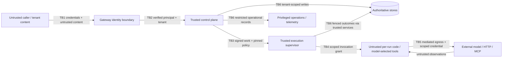

# Threat model

[Design index](README.md) | [Architecture boundaries](architecture.md) | [Data flows](data-flows.md)

**Scope:** design-time STRIDE analysis of the current system and agreed production
target. This is not a penetration test, exploit verification, or security certification.
Controls labeled TARGET remain requirements until implemented and tested.

## 1. Assets and security objectives

| Asset | Required property |
|---|---|
| Tenant identity, membership and roles | Cannot be forged, confused or carried across tenants |
| Prompts, history, outputs and artifacts | Tenant confidentiality, authorized disclosure and bounded retention |
| Model/provider and customer credentials | Minimal scope, no model/log/queue disclosure, revocable use |
| Tool effects and human decisions | Correct actor, exact approved arguments/destination, replay resistance |
| Run state, usage and billing | Integrity, recoverability, unique charging and explainable uncertainty |
| Plugin code and policy revisions | Reviewed provenance, immutability, trustworthy enforcement |
| Availability and spend capacity | Fair resource use, bounded cost and fault containment |
| Audit trail and telemetry | Accountability without becoming a secondary secret/content leak |

Tenant content is untrusted input even when authenticated. Model outputs and remote
tool observations are also untrusted; a model cannot grant privileges.

## 2. Actors and assumptions

* Legitimate tenant user or service principal.
* Malicious tenant with valid credentials, trying to read other customers' data,
  monopolize capacity, inject instructions or invoke unintended effects.
* Internet attacker without credentials.
* Compromised or malicious model/provider, MCP server, integration endpoint or website.
* Compromised plugin artifact or dependency.
* Mistaken/compromised tenant administrator, approver or platform operator.
* Compromised worker/sandbox attempting lateral movement.
* TARGET extensions: malicious or compromised marketplace publisher; malicious peer
  agent (child, sibling or remote A2A agent); external client of the A2A, MCP-server or
  OpenAI-compatible surfaces.

CURRENT assumes trusted installed plugins, trusted private infrastructure and a
correct authenticating gateway. It does not safely accept arbitrary hostile Python
plugins. TARGET assumes secret manager, IdP, KMS and sandbox runtime are maintained
and correctly configured; compromise of those roots remains a residual risk.

## 3. Trust-boundary map (LOGICAL / TARGET)

In the current implementation, several boundaries collapse: plugin import runs in
API/orchestrator processes; tools share a process pool, broker access and scratch
volume; Redis stores secret values and transport/results in the same instance.

## 4. STRIDE scenarios and treatment

Priority **P0** blocks mutually untrusted production tenancy; **P1** is required
before scale/high-impact automation; **P2** is ongoing hardening. Priority is a design
delivery order, not an exploit severity score.

| ID / STRIDE | Scenario and affected flow | Current control / limitation | Required target treatment | Priority |
|---|---|---|---|---|
| TM-01 Spoofing | Caller selects another tenant in create/read/resume/SSE | OIDC/API-key membership verification, canonical tenant selection and initial route action checks; development retains legacy headers and production startup remains blocked pending full policy/admin/audit surfaces | Require verified identity + tenant membership; strip forged internal headers; private API ingress | P0 |
| TM-02 Elevation / disclosure | Cross-tenant run/thread/secret/artifact reference | Verified identity/RBAC, tenant-composite run/thread/policy/revision constraints, forced RLS and transaction-local context; production rejects owner/BYPASSRLS API identities and uncut-over legacy data | Preserve qualification; add artifact/object grants and sandbox/credential isolation in later phases | P0 |
| TM-03 Tampering / elevation | Model or remote observation instructs use of broader tools/secrets | Worker unlock check and active-skill secret declarations | Treat content as data; immutable policy; per-invocation grants; explicit high-risk approvals | P0 |
| TM-04 Elevation | Malicious native plugin executes at API/orchestrator import time | Static manifest first, but runtime discovery imports Python in privileged processes | Static-only catalog in control plane; approved artifacts; import/execution only in qualified sandbox | P0 |
| TM-05 Disclosure / lateral movement | Compromised tool reads sibling secrets from broker, memory, scratch or Redis | Reduced tool container privilege; shared Redis and task secret values remain | No sandbox broker/store credential; secret references; per-run runtime/volumes; per-invocation broker | P0 |
| TM-06 Tampering / repudiation | Forged/stale approval or crash between claim and dispatch | Exact `approval_batches` with digest over the pending calls, state version and expiry; immutable attributed `approval_decisions`; approver RBAC, self-approval denial and single-winner decision CAS (Phase 3) | Exact batch digest, expiry, immutable decision, outbox and fencing | P0 |
| TM-07 Tampering | Redelivered/stale tasks duplicate tools or overwrite terminal state | Fenced leases (`lease_epoch` + `state_version` CAS), `consumer_inbox` dedup, per-invocation `effect_key` forwarded as `Idempotency-Key`; lost outcomes become `unknown`, never auto-retried (Phase 3). Destinations must honour the key for exactly-once effects | Version/epoch CAS, inbox, durable invocation key and destination idempotency/reconciliation | P0 |
| TM-08 Disclosure / elevation | SSRF from endpoint URL or redirect/DNS change reaches metadata/internal systems | Scheme/IP/hostname + preflight DNS checks for manifests/callbacks; redirects disabled; native plugins vary | Mandatory egress mediation, resolution/connection binding, metadata deny, destination allowlist and TLS | P0 |
| TM-09 Disclosure | Secret appears in tool output, SSE preview, exception, provider prompt or logs | Context access checks, but handlers can return secrets; truncation is not redaction | Structured redaction/field allowlists before persistence/model/events/logs; leakage tests; restricted raw diagnostics | P0 |
| TM-10 Spoofing / tampering | Fake/replayed terminal callback triggers customer action | Run callback unsigned; tool HMAC has no nonce/timestamp and signs different serialization | Versioned exact-byte signature, time window, delivery/event IDs, key rotation and receiver dedupe | P1 |
| TM-11 DoS | Tenant floods creates, tool fan-out, SSE connections, large prompts or output | Step cap, tool timeout, observation truncation; no request/concurrency/fairness quota | Admission limits, input/token/byte limits, tenant fair queues, stream caps, sandbox CPU/memory/PID quotas | P0 |
| TM-12 DoS / billing integrity | Cost cap evasion/overshoot or duplicate charges | Pre-dispatch model-cost reservations from configured pricing, NUMERIC `usage_ledger` with per-attempt uniqueness, uncertain reservations counted as spent, deadline and tool-invocation quotas (Phase 3); unpriced models rely on post-step settlement; artifact/egress quotas pending Phase 4 | Pre-dispatch reservations, bounded tokens, unique usage ledger, uncertain-cost reconciliation | P1 |
| TM-13 Tampering / elevation | Plugin/policy drifts during run; tenant grant revoked after admission | Authenticated admission verifies and pins an immutable policy revision, exact model and plugin digests; worker-time revalidation/revocation is not implemented | Immutable plugin/agent/policy digests, revocation epochs, fail-closed incompatible work | P1 |
| TM-14 Repudiation | Cannot attribute who approved or changed policy | Authenticated submitters and successful approval/rejection decisions are actor-attributed; membership, API-key and policy mutations write append-only audit events; break-glass has no actions or grant path | Integrity-protected audit export and a separately approved, time-limited break-glass workflow remain future work | P1 |
| TM-15 Disclosure | Broad inventory/monitoring exposes other tenants or task credentials | Authenticated plugin catalog is filtered by active policy grants and returns a scoped fingerprint; development catalog remains global; production Compose omits Flower and the dev overlay binds it to loopback | Protected production operations plane, no secrets in transport, least-privilege monitoring | P1 |
| TM-16 Tampering / loss | DB commit succeeds but dispatch/event fails; stream trims unobserved result | State, `run_events` and `outbox_messages` commit in one transaction; SKIP LOCKED relay with bounded retries; durable PostgreSQL replay with gap signalling; reconciler for stalled leases/outcomes (Phase 3) | Transactional outbox/events, replay API, stalled-run reconciler, backup/restore drills | P1 |
| TM-17 Disclosure | Expired/deleted run remains in artifacts, backups or task copies | Vault TTL and cleanup only one value; shared spill files no lifecycle | Unified retention, scoped artifacts, deletion tombstones, backup restore filtering and documented erasure delay | P1 |
| TM-18 Elevation / DoS | Sandbox escape, metadata credential theft or host exhaustion | Non-root, dropped capabilities, read-only root; no per-run sandbox | Qualified sandbox runtime, no host mounts/tokens, seccomp, hard limits, patching, dedicated cells | P0 |
| TM-19 Spoofing / disclosure | Stolen token/session or stale SSE remains authorized after revocation | OIDC/API-key verification and membership revocation are implemented; SSE authorization is checked only at connection start and not periodically | Short-lived credentials, CSRF protection for cookie commands, token hygiene, stream reauth/revocation | P1 |
| TM-20 Tampering / DoS | Concurrent runs overwrite shared thread; cross-policy old history confuses model | Tenant ownership only; whole-thread completion update | Thread version/active-run claim, explicit branching, history provenance and current-policy checks | P1 |
| TM-21 Disclosure / repudiation | Operator or telemetry sink accesses unrestricted content | Operator role is denied customer run routes; process-level operations and basic logs remain shared | Separate operational/content roles, least privilege, restricted sinks, audited break-glass | P1 |
| TM-22 Spoofing / tampering | Forged task envelope confuses tenant/cell or reuses credential grant | Tool tasks carry Ed25519-signed, expiring envelopes binding tenant/run/invocation/epoch and an arguments digest; tool workers hold only the verify key (Phase 3). Workload identity and per-cell keys remain Phase 4/6 | Workload identity, envelope authentication, durable-state comparison, expiry and audience-bound grants | P0 |
| TM-23 Elevation / disclosure | Malicious or compromised marketplace publisher ships code that exfiltrates data or credentials | No marketplace; operator-reviewed packs only | Verified publisher identity, automated + manual review, sandbox-only execution, declared-egress enforcement, per-invocation credentials ([marketplace](marketplace.md)) | P0 |
| TM-24 Spoofing | Typosquatted plugin names or dependency confusion between public and private registries | Not applicable | Namespaces, registry precedence pinned per tenant, lockfiles with digests, name-similarity checks | P1 |
| TM-25 Tampering | Benign plugin update or remote MCP server later changes behavior, schemas or tool descriptions (rug pull) | Not applicable | Digest pinning, permission-diff re-consent, MCP schema-digest pinning with change blocking | P0 |
| TM-26 Tampering / elevation | `SKILL.md` or tool descriptions carry prompt injection that steers the model toward other tools/data | Skills are operator-trusted | Prompt-injection lint at review, provenance labelling, enforcement outside prompt (ADR-08), risk-class approvals | P1 |
| TM-27 Elevation | Agent delegates broader capabilities, secrets or budget to a child than it holds (confused deputy) | Not applicable | Attenuable delegation tokens checked against durable parent grants on every spawn and invocation | P0 |
| TM-28 Tampering | Peer agent injects instructions via messages, handoff input or workspace entries | Not applicable | Treat agent messages as untrusted data with provenance; recipient grants unchanged by content; approvals for high-risk effects | P1 |
| TM-29 DoS / billing | Recursive spawn, fan-out storms or budget-tree evasion | Not applicable | Depth, fan-out and descendant caps; ledger sub-reservations; cascade cancellation | P0 |
| TM-30 Spoofing / disclosure | Caller of A2A, MCP-server or OpenAI-compatible surfaces impersonates a tenant or reaches another tenant's agents | Not applicable | Same identity, membership and RBAC path as `/v1`; per-surface audience; scoped agent cards | P0 |
| TM-31 Tampering | Concurrent agents overwrite or poison shared workspace entries | Shared scratch volume, no versioning | Versioned entries, CAS writes, per-agent path scopes, provenance on every version | P1 |
| TM-32 Elevation | OpenAI-compatible facade bypasses approvals, budgets or tool policy | Not applicable | Facade maps to agent revisions only; same admission, policy and approval pipeline; parity tests | P0 |
| TM-33 Disclosure | SDK/CLI leaks tokens via logs, URLs, crash reports or shell history | Client holds secrets in memory; no bearer support | Redacting loggers, header-only credentials, OS keychain storage, device flow | P2 |
| TM-34 Tampering | Registry, signing key or CDN compromise distributes malicious artifacts | Not applicable | Sigstore transparency log, provenance verification at install and launch, key ceremony and rotation, mirror digest checks | P0 |

### Important limits of existing controls

* Phase 2 RLS isolates tenant content for the non-owner API login, including tenant
  registry, memberships, keys, policies, audit, agent revisions, runs and threads.
  Principals are a global identity directory. The fixed-path SECURITY DEFINER tenant
  resolver only returns canonical UUIDs; it is not an identity verifier. Application
  authentication/RBAC remains mandatory: a compromised API process can set another
  tenant context. Execution/maintenance roles intentionally have explicit cross-tenant
  policies and narrow grants; they must never be assigned to the API login.
* Schema-owner policies support trusted migration/bootstrap operations. Migration
  credentials and raw-content quarantine are operator-only trust boundaries, not
  tenant runtime privileges. Nullable legacy development access disappears at cutover.
* Thread claims/version checks protect committed history; Phase 3 execution leases,
  approval-batch fencing and `effect_key`s protect workflow transitions. A redelivered
  tool task can still repeat an effect at a destination that ignores `Idempotency-Key`.

* A DNS preflight check does not bind the subsequent HTTP connection to the same
  resolved address; do not claim it fully defeats rebinding.
* A read-only root filesystem is not a network sandbox or a protection from shared
  memory/process credentials.
* An allowlist in prompt text is advisory. Only enforcement outside model control
  establishes authority.
* A timeout observation may be emitted while a synchronous handler continues its
  effect. Production needs enforceable process termination and effect reconciliation.
* Fingerprints detect repetitions after tools run. They are not transaction
  idempotency keys or preventive controls on third-party effects.
* Secret scoping to all active skills is broader than scoping to the current invocation.
* The tool worker's absent configured DB/model credential does not prove an inability
  to reach those services or execute code at import time elsewhere.

## 5. Abuse-case walkthroughs

### A. Indirect prompt injection through a fetched document

1. Tenant requests research; a page/tool result contains instructions to export secrets.
2. The model may request an unrelated tool or encode content into an outbound call.
3. CURRENT blocks tools that are not unlocked, but active tools and credentials may
   still be powerful enough to cause an authorized-scope leak.
4. TARGET separates read capabilities from write/export capabilities, applies
   destination/data policy, and gates high-impact effects with exact summaries.
   Secret values are never model-visible and no tool can broaden its own grants.
5. Residual: a malicious observation can still degrade answer quality or leak permitted
   data to an allowed provider. Minimize context and choose provider/data policy deliberately.

### B. Worker crashes after a billing action succeeds

1. Destination commits an effect; worker dies before recording the response.
2. Broker redelivers the task.
3. CURRENT (Phase 3): the redelivered task carries the same signed envelope and
   `effect_key`, forwarded as `Idempotency-Key`; a destination that honours it returns the
   original receipt. If no outcome is ever recorded, the reconciler marks the invocation
   `unknown` after `TOOL_OUTCOME_TIMEOUT_SEC` and the run surfaces it instead of retrying.
4. TARGET reuses the stable effect key and looks up the destination receipt. If no
   such mechanism exists, mark the invocation `unknown` and require reconciliation.
   Never treat a retry as automatically safe because its queue task ID is the same.

### C. Tenant tries to impersonate another tenant

1. Caller changes `X-Tenant-ID` to the victim's value.
2. CURRENT cannot distinguish the caller from the victim if the upstream identity
   boundary is absent or allows header forwarding.
3. TARGET strips headers, verifies tenant membership, authorizes the action, sets
   transaction-local tenant context and uses composite foreign keys/RLS.
4. Repeat the same attempt through resume, SSE, artifact grants, secret references,
   callbacks, worker envelopes and connection-pool reuse.

## 6. Security acceptance tests (TARGET release gates)

| Test | Required observation | Threats |
|---|---|---|
| SEC-01 Identity/tenant matrix | Invalid/expired/wrong-audience credential rejected; unauthorized tenant selection denied; no default production tenant | TM-01, TM-19 |
| SEC-02 Object boundary matrix | Foreign IDs return no data/effects for read, create-thread reuse, resume, cancel, stream, artifact, secret and delivery replay | TM-02 |
| SEC-03 RLS and pool reuse | Direct queries/writes/joins cannot cross tenant; connection reuse does not inherit prior tenant | TM-02 |
| SEC-04 Capability injection | Malicious prompt/tool output cannot unlock a denied tool, broaden secret grant or change destination policy | TM-03, TM-09 |
| SEC-05 Import/runtime boundary | Canary plugin cannot execute in API/orchestrator; sandbox cannot access host, metadata, broker or stores | TM-04, TM-05, TM-18 |
| SEC-06 Approval binding | Unauthorized/self-disallowed/stale/digest-mismatched/expired approval has no effect; racing decisions produce one durable decision | TM-06 |
| SEC-07 Crash and replay | Crash at every state/dispatch/effect boundary preserves terminal integrity; duplicate transport does not repeat supported effects | TM-07, TM-16 |
| SEC-08 Egress adversarial set | Private IPv4/IPv6, mapped IP, redirect, DNS-change, metadata and unauthorized native socket attempts blocked | TM-08 |
| SEC-09 Secret canaries | Canary values absent from model inputs, queues/results, SSE, callbacks, general logs, artifacts and telemetry | TM-05, TM-09, TM-17 |
| SEC-10 Delivery verification | Tampered/expired/wrong-key/replayed callback rejected; valid redelivery is deduplicated | TM-10 |
| SEC-11 Noisy neighbor | One tenant reaching quotas does not exhaust another's reserved capacity or unlimited SSE/storage | TM-11, TM-12 |
| SEC-12 Revocation | Suspended tenant/old epoch cannot dispatch, refresh grants or keep authorized streams indefinitely | TM-13, TM-19, TM-22 |
| SEC-13 Attribution and operations | Approvals/policy changes/replays/break-glass carry verified actor; monitoring exposes no credentials | TM-14, TM-15, TM-21 |
| SEC-14 Retention/restore | Deletion removes projections and artifacts; restoring a backup reapplies deletion tombstones | TM-17 |
| SEC-15 Thread fencing | Racing creates produce one active run or explicit branch; stale completion cannot overwrite newer history | TM-20 |
| SEC-16 Signature and provenance | Unsigned, wrongly signed, untraceable or digest-mismatched artifacts are rejected at publish, install and sandbox launch | TM-23, TM-34 |
| SEC-17 Declared vs observed behavior | Canary plugin attempting undeclared egress, secrets, workspace paths or syscalls is blocked and flagged in review and at run time | TM-23, TM-26 |
| SEC-18 Upgrade re-consent | Permission-expanding update or changed MCP tool schema is not used until re-consent; non-expanding update follows policy | TM-25 |
| SEC-19 Yank and revocation | Yanked/revoked revision cannot be installed or dispatched; in-flight runs are fenced | TM-23, TM-25, TM-34 |
| SEC-20 Delegation attenuation | No spawn, handoff or message yields a child capability, secret, destination, path or budget outside the parent's | TM-27 |
| SEC-21 Spawn and budget limits | Depth, fan-out and descendant caps hold; descendant spend never exceeds the root reservation | TM-29 |
| SEC-22 Cross-agent injection containment | Malicious messages/workspace entries cannot unlock tools or widen grants of the recipient; workspace scopes and CAS hold | TM-28, TM-31 |
| SEC-23 Interop surface authorization | A2A, MCP-server and OpenAI-compatible callers pass the SEC-01/02 matrix; agent cards expose only granted agents | TM-30 |
| SEC-24 Facade policy parity | Every policy/approval/budget denial on `/v1` reproduces through the OpenAI-compatible facade | TM-32 |
| SEC-25 Cascade | Cancelling, suspending or revoking any run-tree node fences all descendants; descendant approvals require root-tenant approver RBAC | TM-27, TM-29 |
| SEC-26 Client credential hygiene | Canary tokens absent from SDK/CLI logs, errors, URLs and telemetry | TM-33 |

Test names are proposed acceptance identifiers, not claims about existing test coverage.
Existing unit/E2E tests are a baseline, not a substitute for these adversarial checks.

## 7. Residual risks and incident response

Even after controls, provider compromise, authorized insider misuse, novel sandbox
escapes, inference from permitted data and ambiguous third-party effects remain possible.
Dedicated cells reduce blast radius, not all common-control-plane risks.

On suspected leakage or unsafe execution:

1. Suspend tenant/run dispatch and increment revocation/lease epoch.
2. Revoke outstanding credential/artifact grants and affected provider secrets.
3. Terminate relevant sandboxes; isolate the cell if scope is unknown.
4. Preserve minimal immutable evidence (event IDs, policy/plugin digests, actor/effect
   receipts) in restricted storage, not broad raw-content dumps.
5. Reconcile external effects and callback deliveries before replaying any work.
6. Notify impacted parties under agreed incident policy, verify containment and
   regression tests, then deliberately re-enable admission.

Suggested ownership: platform/security own identity, runtime and incident controls;
service engineering owns state/dispatch integrity; tenant administrators own capability
and destination grants; integration owners own destination idempotency/signature
verification. Assign named operational owners before production.
