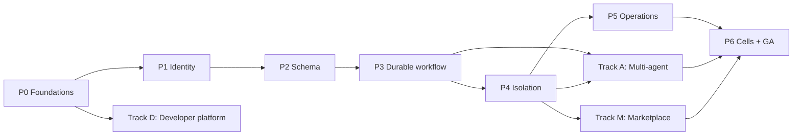

# HaaS production-readiness roadmap

**Living document.** Update the status column in the same pull request that delivers an
item, together with its tests and docs. An item is ✅ only when its listed gates pass in CI or
in a recorded qualification run. Design references: [design set](design/README.md),
[ADRs](adr/README.md).

Status: ✅ done · 🚧 in progress · ⬜ not started · ⛔ blocked

## Goal

Turn the current trusted single-domain Compose stack into a multi-tenant
Harness-as-a-Service that meets every TARGET in the [SDD](design/sdd.md),
[architecture](design/architecture.md), [data model](design/data-model.md),
[integrations](design/integrations-usage.md), [threat model](design/threat-model.md) and
[operations](design/operations-migration.md) documents. On top of that, the roadmap adds three
product tracks:

* an **open plugin marketplace** ([design](design/marketplace.md))
* **distributed multi-agent collaboration** (HACP, A2A, MCP server, OpenAI-compatible
  facade; [design](design/multi-agent.md))
* a **developer platform** (contract-first API, Python/TypeScript SDKs, unified CLI;
  [design](design/developer-platform.md))

## Decisions in force

| Topic | Decision |
|---|---|
| Execution engine | Celery as transport; correctness in PostgreSQL outbox/leases/fencing (ADR-09) |
| Marketplace | Open public with trust tiers + private registries; code only in sandboxes (ADR-10, ADR-11) |
| Plugin formats | Agent Skills, MCP (remote + sandboxed stdio), OpenClaw/ClawHub import, OpenAPI → tools |
| Agent protocols | Native HACP, A2A in/out, agents as MCP server, OpenAI-compatible facade (ADR-12) |
| SDKs | Python and TypeScript; React widgets optional |
| Deployment | Cloud-agnostic Kubernetes (Helm + Terraform); Compose stays the dev profile |

## Invariants every item must respect

1. PostgreSQL is authoritative; Redis is transport and projection only.
2. Prompt content never grants authority; delegation only attenuates.
3. Untrusted code (marketplace, community, tenant) runs only in a qualified per-run sandbox.
4. At-least-once transport, durable invocation identity, destination idempotency or explicit `unknown`.
5. Every feature ships with migration, RLS policy, authorization check, audit event, metrics,
   security test, docs and SDK surface.
6. The `prod` profile fails closed when a required control is missing.

## Dependency overview

Marketplace items that need no code execution (skill-only plugins, private registries,
remote MCP/OpenAPI through the egress proxy) may ship before P4. Code plugins from
third-party publishers must wait until SEC-05, SEC-08 and SEC-09 pass.

---

## Phase 0 — Foundations and baseline

| ID | Item | Depends on | Gates | Status |
|---|---|---|---|---|
| p0-design-scope | Bring marketplace, multi-agent and developer platform into design scope (SDD FR-15..24, ADR-09..12, TM-23..34, SEC-16..26, ERD §4a) | — | Docs review | ✅ |
| p0-roadmap-doc | This roadmap, linked from README and design index | p0-design-scope | — | ✅ |
| p0-ci | GitHub Actions: ruff, pyright, pytest, Compose E2E, coverage, pip-audit, gitleaks, Trivy, SBOM, CodeQL | — | CI green on main | ⬜ |
| p0-migrations | Alembic baseline of current schema; separate advisory-locked migration job; remove startup DDL | — | Upgrade/downgrade test | ⬜ |
| p0-profiles | `dev` / `prod` profiles; prod refuses header tenancy, default tenant, placeholder keys, open Flower/stores | — | Startup fail-closed tests | ⬜ |
| p0-observability-base | JSON logs with redaction filter, OpenTelemetry for API/Celery/httpx, `/livez` + `/readyz` | — | Trace across API→worker in E2E | ⬜ |
| p0-quick-wins | Cancel endpoint, run listing (cursor), body/prompt limits, problem+json, unique MCP JSON-RPC ids, orphan reaper, scratchpad GC, encrypted Redis secrets | p0-migrations | Unit + E2E | ⬜ |
| p0-baseline-tests | Freeze E2E as regression; OpenAPI snapshot of `/v1` | p0-ci | CI | ⬜ |

## Phase 1 — Identity and tenant authority

| ID | Item | Depends on | Gates | Status |
|---|---|---|---|---|
| p1-authn | OIDC JWT (JWKS rotation) + tenant-scoped hashed API keys; header stripping | p0-profiles | SEC-01 | ⬜ |
| p1-tenant-registry | Tenants, principals, memberships, lifecycle state machine, revocation epoch, bootstrap admin | p0-migrations | SEC-02 | ⬜ |
| p1-rbac | Policy decision point; admin/submitter/approver/auditor/operator/break-glass | p1-authn, p1-tenant-registry | SEC-02, SEC-13 | ⬜ |
| p1-tenant-policy | Deny-by-default models, destinations, plugin grants, budgets, retention (replaces `TENANT_SKILL_ALLOWLISTS`) | p1-rbac | SEC-04 | ⬜ |
| p1-admin-api | Tenant/member/API-key/policy endpoints + CLI | p1-rbac, p1-tenant-policy | SEC-13 | ⬜ |
| p1-scoped-inventory | Grant-filtered `/v1/plugins`; Flower behind operator auth or removed in prod | p1-tenant-policy | TM-15 | ⬜ |
| p1-audit-v1 | Append-only audit with verified actor | p1-rbac | SEC-13 | ⬜ |

## Phase 2 — Tenant-aware schema

| ID | Item | Depends on | Gates | Status |
|---|---|---|---|---|
| p2-schema-expand | Target ERD tables, `(tenant_id, id)` keys, composite FKs, TIMESTAMPTZ, NUMERIC, state checks | p1-tenant-registry | Migration review | ⬜ |
| p2-rls | Non-owner role, forced RLS, `SET LOCAL` tenant, pool-reuse tests | p2-schema-expand | SEC-03 | ⬜ |
| p2-agent-revisions | Draft → validate → publish immutable agent revisions; runs pin them | p1-tenant-policy, p2-schema-expand | FR-14 | ⬜ |
| p2-legacy-migration | Tenant mapping, backfill, quarantine, drain-to-terminal cutover | p2-rls | Migration counts | ⬜ |
| p2-thread-fencing | `history_version`, one active run per thread, explicit branching | p2-schema-expand | SEC-15 | ⬜ |

## Phase 3 — Durable workflow correctness

| ID | Item | Depends on | Gates | Status |
|---|---|---|---|---|
| p3-outbox-relay | Transactional outbox, SKIP LOCKED relay, consumer inbox | p2-schema-expand | TM-16 | ⬜ |
| p3-leases-fencing | Lease epoch + state version CAS; signed execution envelope | p3-outbox-relay | SEC-07, TM-22 | ⬜ |
| p3-steps-invocations | Step attempts, invocation `effect_key`, outcomes independent of result backend, `unknown` | p3-leases-fencing | SEC-07 | ⬜ |
| p3-approvals-v2 | Batch digest, expiry, approver RBAC, idempotent immutable decisions, `waiting_approval` | p1-rbac, p3-steps-invocations | SEC-06 | ⬜ |
| p3-cancellation | Fenced cancel, suspension revocation, cascade hooks | p3-leases-fencing | FR-13, SEC-12 | ⬜ |
| p3-admission-idempotency | `Idempotency-Key` with request digest | p3-outbox-relay | FR-01 | ⬜ |
| p3-budget-ledger | Pre-dispatch reservations, NUMERIC ledger, deadline/tool/artifact/egress quotas | p3-steps-invocations | TM-12 | ⬜ |
| p3-durable-events | `run_event` sequence + schema version, PG replay, gap response, heartbeat, reauth | p3-outbox-relay | FR-08 | ⬜ |
| p3-reconciler | Stalled-work reconciler; crash-boundary fault injection in CI | p3-durable-events, p3-steps-invocations | SEC-07 | ⬜ |

## Phase 4 — Execution isolation and credentials

| ID | Item | Depends on | Gates | Status |
|---|---|---|---|---|
| p4-static-catalog | No plugin imports in control plane; build-time schema extraction | p2-agent-revisions | SEC-05 | ⬜ |
| p4-plugin-artifacts | Content-addressed OCI plugin artifacts pinned per run | p4-static-catalog | FR-14 | ⬜ |
| p4-sandbox-protocol | Supervisor↔sandbox RPC; `haas-plugin-sdk` with versioned ABI | p4-static-catalog | Contract tests | ⬜ |
| p4-sandbox-runtime | Runtime ADR-13; per-run sandbox limits, no tokens/metadata/host mounts, enforced kill | p4-plugin-artifacts, p4-sandbox-protocol | SEC-05, TM-18 | ⬜ |
| p4-credential-broker | Secret bindings, per-invocation audience-bound grants, no raw secrets in transport | p2-rls, p3-steps-invocations | SEC-09, FR-10 | ⬜ |
| p4-egress-proxy | Destination policy, DNS pinning, private/metadata deny, TLS, byte quotas | p1-tenant-policy | SEC-08 | ⬜ |
| p4-redaction | Redaction/field allowlists for model, events, logs, callbacks; canaries | p3-durable-events | SEC-09 | ⬜ |
| p4-artifact-service | Tenant/run-scoped object storage replacing scratchpad | p2-rls | SEC-02, TM-17 | ⬜ |

## Phase 5 — Service operation

| ID | Item | Depends on | Gates | Status |
|---|---|---|---|---|
| p5-signed-webhooks | Raw-body HMAC v1, key rotation, delivery ledger, DLQ, replay | p3-outbox-relay | SEC-10 | ⬜ |
| p5-quotas-fairness | Rate limits, concurrency reservations, weighted fair queues, SSE and fan-out caps | p3-budget-ledger | SEC-11 | ⬜ |
| p5-retention | Retention classes, tombstones, erasure, offboarding receipts, legal hold | p4-artifact-service | SEC-14 | ⬜ |
| p5-telemetry | Ops §5 metrics, alerts, restricted diagnostics, SLO burn alerts | p0-observability-base | Alert drills | ⬜ |
| p5-backup-dr | PITR, restore drills, epoch fencing after restore | p3-leases-fencing | RPO/RTO drill | ⬜ |
| p5-k8s-helm | Helm charts, Terraform modules, NetworkPolicies, PodSecurity, KEDA, runbooks | p4-egress-proxy, p4-sandbox-runtime | Staging deploy | ⬜ |
| p5-load-slo | Skewed multi-tenant load against proposed SLOs | p5-k8s-helm, p5-quotas-fairness | SLO report | ⬜ |

## Phase 6 — Cells and general availability

| ID | Item | Depends on | Gates | Status |
|---|---|---|---|---|
| p6-cells | Durable placement with fencing; dedicated cells | p5-k8s-helm | Isolation/failover test | ⬜ |
| p6-security-qualification | SEC-01..SEC-26, external pentest, threat-model refresh | p6-cells, m-install-grants, a-attenuation-budget | Full matrix | ⬜ |
| p6-launch | Canary tenants, on-call, status page, go-live review | p6-security-qualification, p5-load-slo, p5-backup-dr | Go-live review | ⬜ |

---

## Track D — Developer platform

| ID | Item | Depends on | Gates | Status |
|---|---|---|---|---|
| d-api-contract | OpenAPI 3.1, event JSON Schemas, AsyncAPI, Spectral + oasdiff, deprecation policy (ADR-16) | p0-ci | FR-23 | ⬜ |
| d-api-ergonomics | Cursors, filters, problem+json, Idempotency-Key, request IDs, rate-limit headers | d-api-contract | FR-23 | ⬜ |
| d-sdk-python | Sync/async client, typed events, reconnecting streams, approvals, webhook verify, OTel | d-api-ergonomics, p1-authn | FR-24, SEC-26 | ⬜ |
| d-sdk-typescript | Runtime-agnostic SDK with fetch SSE + auth, ESM/CJS, generated types | d-api-ergonomics, p1-authn | FR-24, SEC-26 | ⬜ |
| d-cli | Unified `haas` CLI (login, runs, agents, approvals, plugins, dev, webhooks listen, chat) | d-sdk-python | FR-24 | ⬜ |
| d-local-dev | `haas dev`, mock model provider, seed data, test-mode keys | p0-profiles | Quickstart in CI | ⬜ |
| d-docs-portal | Quickstarts, references, cookbook, migration guides, changelog | d-api-contract | Docs build in CI | ⬜ |
| d-examples | FastAPI, Next.js, Slack bot, GitHub Action, Postman/Bruno | d-sdk-python, d-sdk-typescript | Examples tested in CI | ⬜ |
| d-openai-compat | `/v1/chat/completions` + Responses facade over agent revisions | p2-agent-revisions, p3-durable-events | SEC-24 | ⬜ |
| d-token-streaming | Optional `run.output.delta` events | p3-durable-events | Contract tests | ⬜ |
| d-react-widgets | Optional chat/timeline/approval components | d-sdk-typescript | — | ⬜ |

## Track M — Open plugin marketplace

| ID | Item | Depends on | Gates | Status |
|---|---|---|---|---|
| m-design | [Marketplace design](design/marketplace.md) | p0-design-scope | Docs review | ✅ |
| m-manifest-v2 | Manifest v2: semver, api_version, permissions, risk classes, sandbox profile, SBOM | m-design | FR-15 | ⬜ |
| m-publisher-identity | Publisher accounts, domain verification, 2FA, namespaces + per-run aliases (ADR-11) | m-design, p1-authn | TM-24 | ⬜ |
| m-signing-provenance | Sigstore/cosign, SLSA, transparency log, verify at install and launch | p4-plugin-artifacts | SEC-16 | ⬜ |
| m-registry-service | Publish/yank/search/versions/download-by-digest; private registries; mirrors | m-manifest-v2, m-publisher-identity, m-signing-provenance | FR-15 | ⬜ |
| m-review-pipeline | Static + dependency + secret scans, permission diff, sandboxed behavior test, injection lint | m-registry-service, p4-sandbox-runtime | SEC-17 | ⬜ |
| m-trust-tiers | platform/verified/community/private/unreviewed in tenant policy | m-review-pipeline, p1-tenant-policy | FR-16 | ⬜ |
| m-install-grants | Digest-pinned installs, consent, re-consent on expansion, revocation epochs | m-trust-tiers, p2-agent-revisions, p4-credential-broker, p4-egress-proxy | SEC-18, SEC-19 | ⬜ |
| m-format-adapters | Agent Skills, ClawHub importer, OpenAPI generator, remote MCP (rug-pull pinning), stdio MCP in sandbox | m-manifest-v2, p4-sandbox-protocol | FR-18, SEC-18 | ⬜ |
| m-dev-tooling | `haas plugin test/pack/sign/publish`, CI template, local registry | m-manifest-v2, d-cli | FR-24 | ⬜ |
| m-discovery-ui | Search/browse API + web UI, badges, permissions, security reports, install flow | m-registry-service | FR-16 | ⬜ |
| m-ecosystem-ops | Abuse reports, takedowns, advisories, publisher analytics, monetization hooks | m-install-grants | FR-17 | ⬜ |

## Track A — Distributed multi-agent collaboration

| ID | Item | Depends on | Gates | Status |
|---|---|---|---|---|
| a-design | [HACP design](design/multi-agent.md) | p0-design-scope | Docs review | ✅ |
| a-schema | Run tree, delegations, mailboxes, workspaces, agent cards (ERD §4a) | a-design, p2-schema-expand | SEC-03 | ⬜ |
| a-primitives | `write_todos`, spawn/delegate, handoff, messages, workspace CAS/watch, join, cancel; outbox wake-ups | a-schema, p3-outbox-relay, p3-cancellation, p4-artifact-service | FR-19, FR-21 | ⬜ |
| a-topologies | Supervisor, hierarchical, swarm, graph, map-reduce, debate; publish-time validation | a-primitives, p2-agent-revisions | FR-19 | ⬜ |
| a-attenuation-budget | Delegation tokens (ADR-15), child ⊆ parent, ledger sub-reservations, spawn caps | a-primitives, p3-budget-ledger | SEC-20, SEC-21 | ⬜ |
| a-hitl-cancel-cascade | Descendant approvals at root, cascade cancel/suspend, failure policies | a-primitives, p3-approvals-v2 | SEC-25 | ⬜ |
| a-observability | `/v1/runs/{id}/tree`, aggregated stream, per-agent cost, trace links, TUI tree | a-primitives, p3-durable-events | — | ⬜ |
| a-a2a | A2A server (agent cards) and egress-mediated A2A client tool | a-topologies, p1-authn, p4-egress-proxy | SEC-23 | ⬜ |
| a-mcp-server | Published agents exposed via tenant MCP endpoint (Streamable HTTP, OAuth) | a-topologies, p1-authn | SEC-23 | ⬜ |
| a-openai-facade-agents | OpenAI facade targeting multi-agent revisions | a-topologies, d-openai-compat | SEC-24 | ⬜ |
| a-sdk-dsl | Agents-as-code builders in Python/TS, local simulation, deepagents/LangGraph migration guide | a-topologies, d-sdk-python, d-sdk-typescript | FR-24 | ⬜ |
| a-evals | Multi-agent eval harness with mock model in CI | a-topologies, d-local-dev | Eval report | ⬜ |

---

## Suggested first wave

These have no unmet dependencies and can proceed in parallel: `p0-ci`, `p0-migrations`,
`p0-profiles`, `p0-observability-base`. They unblock `p0-quick-wins`, `p0-baseline-tests`,
`p1-authn`, `p1-tenant-registry`, `d-api-contract` and `d-local-dev`.

## Open decisions

ADR-13 sandbox runtime, ADR-14 IdP and secret manager, ADR-15 delegation token format,
ADR-16 docs/SDK toolchain; also object store, observability vendor, registry CDN and
regional residency. See the [ADR index](adr/README.md).
