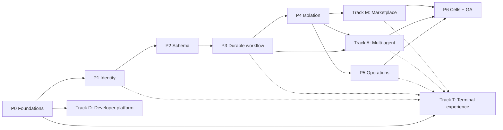

# HaaS production-readiness roadmap

**Living document.** Update the status column in the same pull request that delivers an
item, together with its tests and docs. An item is ✅ only when its listed gates pass in CI or
in a recorded qualification run. Design references: [design set](design/README.md),
[ADRs](adr/README.md).

Status: ✅ done · 🚧 in progress · ⬜ not started · ⛔ blocked

## Goal

Turn the current trusted single-domain Compose stack into a multi-tenant
Harness-as-a-Service that meets every TARGET in the [SDD](design/sdd.md),
[architecture](design/architecture.md), [data model](design/data-model.md),
[integrations](design/integrations-usage.md), [threat model](design/threat-model.md) and
[operations](design/operations-migration.md) documents. On top of that, the roadmap adds four
product tracks:

* an **open plugin marketplace** ([design](design/marketplace.md))
* **distributed multi-agent collaboration** (HACP, A2A, MCP server, OpenAI-compatible
  facade; [design](design/multi-agent.md))
* a **developer platform** (contract-first API, Python/TypeScript SDKs, unified CLI;
  [design](design/developer-platform.md))
* a **first-class terminal experience** (mission control, agent workbench, approvals,
  marketplace and operations; [design](design/tui-experience.md))

## Decisions in force

| Topic | Decision |
|---|---|
| Execution engine | Celery as transport; correctness in PostgreSQL outbox/leases/fencing (ADR-09) |
| Marketplace | Open public with trust tiers + private registries; code only in sandboxes (ADR-10, ADR-11) |
| Plugin formats | Agent Skills, MCP (remote + sandboxed stdio), OpenClaw/ClawHub import, OpenAPI → tools |
| Agent protocols | Native HACP, A2A in/out, agents as MCP server, OpenAI-compatible facade (ADR-12) |
| SDKs | Python and TypeScript; React widgets optional |
| Deployment | Cloud-agnostic Kubernetes (Helm + Terraform); Compose stays the dev profile |
| Terminal product | Evolve the Textual TUI into `haas chat`; share authorized API/SDK contracts, keyboard-first progressive disclosure; no web-UI dependency |

## Invariants every item must respect

1. PostgreSQL is authoritative; Redis is transport and projection only.
2. Prompt content never grants authority; delegation only attenuates.
3. Untrusted code (marketplace, community, tenant) runs only in a qualified per-run sandbox.
4. At-least-once transport, durable invocation identity, destination idempotency or explicit `unknown`.
5. Every feature ships with migration, RLS policy, authorization check, audit event, metrics,
   security test, docs and SDK surface.
6. The `prod` profile fails closed when a required control is missing.
7. A user-facing capability is not release-complete until its Track T journey, authorization,
   error/recovery states, keyboard tests and usage docs ship in the same milestone.
   Backend groundwork can merge first; non-user-facing exemptions must be explicit.

## Dependency overview

Marketplace items that need no code execution (skill-only plugins, private registries,
remote MCP/OpenAPI through the egress proxy) may ship before P4. Code plugins from
third-party publishers must wait until SEC-05, SEC-08 and SEC-09 pass.

### Terminal delivery alongside each phase

Do the **T0 bridge before Phase 1 implementation**; it closes the gap between Phase 0's
API and today's chat UI. Subsequent waves ship with their server capabilities, not after GA.
Uncompleted Track T rows remain targets; completed increments are qualified below.

| Server milestone | Required terminal increment |
|---|---|
| Before Phase 1 | `t0-foundation`, `t0-run-control`, `t0-qualification`: navigation, run list/reattach/cancel, safe input and terminal tests |
| Phase 1 | `t1-identity`, `t1-administration`: authenticated profiles, tenant context, role-aware administration |
| Phase 2 | `t2-agents`, `t2-threads`: agent revisions, thread history/branches/conflicts |
| Phase 3 | `t3-inspector`, `t3-approvals`, `t3-budgets`: durable timeline/recovery, decisions and cost; `t3-output` when token streaming ships |
| Phase 4 | `t4-artifacts`, `t4-access`: evidence/workspace previews, credential bindings, sandbox/egress policy explanations |
| Phase 5 | `t5-operations`, `t5-performance`: service diagnostics, webhook/retention workflows and large-session quality |
| Marketplace / multi-agent / developer tracks | `t-m-*`, `t-a-*`, `t-d-*` ship incrementally with the corresponding APIs |
| Phase 6 | `t6-qualification`: cross-role, safety, terminal, compatibility and usability gates before launch |

---

## Phase 0 — Foundations and baseline

| ID | Item | Depends on | Gates | Status |
|---|---|---|---|---|
| p0-design-scope | Bring marketplace, multi-agent and developer platform into design scope (SDD FR-15..24, ADR-09..12, TM-23..34, SEC-16..26, ERD §4a) | — | Docs review | ✅ |
| p0-roadmap-doc | This roadmap, linked from README and design index | p0-design-scope | — | ✅ |
| p0-ci | GitHub Actions: ruff, pyright, pytest, Compose E2E, coverage, pip-audit, gitleaks, Trivy, SBOM, CodeQL | — | CI green on main | 🚧 |
| p0-migrations | Alembic baseline of current schema; separate advisory-locked migration job; remove startup DDL | — | Upgrade/downgrade test | ✅ |
| p0-profiles | `dev` / `prod` profiles; prod refuses header tenancy, default tenant, placeholder keys, open Flower/stores | — | Startup fail-closed tests | ✅ |
| p0-observability-base | JSON logs with redaction filter, OpenTelemetry for API/Celery/httpx, `/livez` + `/readyz` | — | Trace across API→worker in E2E | ✅ |
| p0-quick-wins | Cancel endpoint, run listing (cursor), body/prompt limits, problem+json, unique MCP JSON-RPC ids, orphan reaper, scratchpad GC, encrypted Redis secrets | p0-migrations | Unit + E2E | ✅ |
| p0-baseline-tests | Freeze E2E as regression; OpenAPI snapshot of `/v1` | p0-ci | CI | 🚧 |

## Phase 1 — Identity and tenant authority

| ID | Item | Depends on | Gates | Status |
|---|---|---|---|---|
| p1-authn | OIDC JWT (JWKS rotation) + tenant-scoped hashed API keys; header stripping | p0-profiles, t0-qualification | SEC-01 | ✅ |
| p1-tenant-registry | Tenants, principals, memberships, lifecycle state machine, revocation epoch, bootstrap admin | p0-migrations, t0-qualification | SEC-02 | ✅ |
| p1-rbac | Deny-by-default action policy; separated submitter/approver, auditor/operator isolation; break-glass remains actionless without a separately approved grant | p1-authn, p1-tenant-registry | SEC-02, SEC-13 | ✅ |
| p1-tenant-policy | Immutable deny-by-default policy revisions; exact models, plugin digests/skills, webhook hosts, budgets and retention | p1-rbac | SEC-04 | ✅ |
| p1-admin-api | Tenant/member/API-key/policy endpoints + CLI | p1-rbac, p1-tenant-policy | SEC-13 | ✅ |
| p1-scoped-inventory | Grant-filtered `/v1/plugins`; Flower omitted from production Compose and loopback-only in dev | p1-tenant-policy | TM-15 | ✅ |
| p1-audit-v1 | Append-only audit with verified actor | p1-rbac | SEC-13 | ✅ |

## Phase 2 — Tenant-aware schema

| ID | Item | Depends on | Gates | Status |
|---|---|---|---|---|
| p2-schema-expand | Tenant/internal UUID keys, TIMESTAMPTZ/NUMERIC shadows, tenant-composite constraints and finite state/cost checks; preserve `/v1` aliases, sync writes and contract required fields at explicit cutover | p1-tenant-registry | Migration review; mapped/unmapped and cross-tenant-write qualification; state rejection; backfill counts | ✅ |
| p2-rls | Separate non-owner API/execution logins, forced RLS, transaction-local tenant context, pool-reuse tests and fail-closed production startup | p2-schema-expand | SEC-03 | ✅ |
| p2-agent-revisions | Immutable draft → validated → published revisions; policy/registry validation, audited transitions and revision-pinned admission | p1-tenant-policy, p2-schema-expand | FR-14 configuration pinning; signed plugin artifacts remain P4 | ✅ |
| p2-legacy-migration | Administrator-referenced audited mapping, bounded backfill, operator-only quarantine, drain-to-terminal cutover and downgrade guards | p2-rls | Migration counts; active-run/unresolved-row refusal | ✅ |
| p2-thread-fencing | Atomic `history_version`/one-active-run claims and completion; scoped thread/history/branch APIs; cancel/reaper release | p2-schema-expand | SEC-15 | ✅ |

Phase 2 builds core ownership/configuration/history foundations, not empty versions of
every future ERD entity. Steps/invocations/outbox/events/usage-ledger tables ship with
their Phase 3 state machines; artifacts, credentials, marketplace and collaboration
tables remain in their owning phases. Existing data is **not** silently migrated by
deploying these changes: follow the [operator runbook](design/operations-migration.md#phase-2-operator-runbook).

## Phase 3 — Durable workflow correctness

| ID | Item | Depends on | Gates | Status |
|---|---|---|---|---|
| p3-outbox-relay | Transactional outbox, SKIP LOCKED relay, consumer inbox | p2-schema-expand | TM-16 | ⬜ |
| p3-leases-fencing | Lease epoch + state version CAS; signed execution envelope | p3-outbox-relay | SEC-07, TM-22 | ⬜ |
| p3-steps-invocations | Step attempts, invocation `effect_key`, outcomes independent of result backend, `unknown` | p3-leases-fencing | SEC-07 | ⬜ |
| p3-approvals-v2 | Batch digest, expiry, approver RBAC, idempotent immutable decisions, `waiting_approval` | p1-rbac, p3-steps-invocations | SEC-06 | ⬜ |
| p3-cancellation | Fenced cancel, suspension revocation, cascade hooks | p3-leases-fencing | FR-13, SEC-12 | ⬜ |
| p3-admission-idempotency | `Idempotency-Key` with request digest | p3-outbox-relay | FR-01 | ⬜ |
| p3-budget-ledger | Pre-dispatch reservations, NUMERIC ledger, deadline/tool/artifact/egress quotas | p3-steps-invocations | TM-12 | ⬜ |
| p3-durable-events | `run_event` sequence + schema version, PG replay, gap response, heartbeat, reauth | p3-outbox-relay | FR-08 | ⬜ |
| p3-reconciler | Stalled-work reconciler; crash-boundary fault injection in CI | p3-durable-events, p3-steps-invocations | SEC-07 | ⬜ |

## Phase 4 — Execution isolation and credentials

| ID | Item | Depends on | Gates | Status |
|---|---|---|---|---|
| p4-static-catalog | No plugin imports in control plane; build-time schema extraction | p2-agent-revisions | SEC-05 | ⬜ |
| p4-plugin-artifacts | Content-addressed OCI plugin artifacts pinned per run | p4-static-catalog | FR-14 | ⬜ |
| p4-sandbox-protocol | Supervisor↔sandbox RPC; `haas-plugin-sdk` with versioned ABI | p4-static-catalog | Contract tests | ⬜ |
| p4-sandbox-runtime | Runtime ADR-13; per-run sandbox limits, no tokens/metadata/host mounts, enforced kill | p4-plugin-artifacts, p4-sandbox-protocol | SEC-05, TM-18 | ⬜ |
| p4-credential-broker | Secret bindings, per-invocation audience-bound grants, no raw secrets in transport | p2-rls, p3-steps-invocations | SEC-09, FR-10 | ⬜ |
| p4-egress-proxy | Destination policy, DNS pinning, private/metadata deny, TLS, byte quotas | p1-tenant-policy | SEC-08 | ⬜ |
| p4-redaction | Redaction/field allowlists for model, events, logs, callbacks; canaries | p3-durable-events | SEC-09 | ⬜ |
| p4-artifact-service | Tenant/run-scoped object storage replacing scratchpad | p2-rls | SEC-02, TM-17 | ⬜ |

## Phase 5 — Service operation

| ID | Item | Depends on | Gates | Status |
|---|---|---|---|---|
| p5-signed-webhooks | Raw-body HMAC v1, key rotation, delivery ledger, DLQ, replay | p3-outbox-relay | SEC-10 | ⬜ |
| p5-quotas-fairness | Rate limits, concurrency reservations, weighted fair queues, SSE and fan-out caps | p3-budget-ledger | SEC-11 | ⬜ |
| p5-retention | Retention classes, tombstones, erasure, offboarding receipts, legal hold | p4-artifact-service | SEC-14 | ⬜ |
| p5-telemetry | Ops §5 metrics, alerts, restricted diagnostics, SLO burn alerts | p0-observability-base | Alert drills | ⬜ |
| p5-backup-dr | PITR, restore drills, epoch fencing after restore | p3-leases-fencing | RPO/RTO drill | ⬜ |
| p5-k8s-helm | Helm charts, Terraform modules, NetworkPolicies, PodSecurity, KEDA, runbooks | p4-egress-proxy, p4-sandbox-runtime | Staging deploy | ⬜ |
| p5-load-slo | Skewed multi-tenant load against proposed SLOs | p5-k8s-helm, p5-quotas-fairness | SLO report | ⬜ |

## Phase 6 — Cells and general availability

| ID | Item | Depends on | Gates | Status |
|---|---|---|---|---|
| p6-cells | Durable placement with fencing; dedicated cells | p5-k8s-helm | Isolation/failover test | ⬜ |
| p6-security-qualification | SEC-01..SEC-26, external pentest, threat-model refresh | p6-cells, m-install-grants, a-attenuation-budget | Full matrix | ⬜ |
| p6-launch | Canary tenants, on-call, status page, go-live review | p6-security-qualification, p5-load-slo, p5-backup-dr, t6-qualification | Go-live review | ⬜ |

---

## Track D — Developer platform

| ID | Item | Depends on | Gates | Status |
|---|---|---|---|---|
| d-api-contract | OpenAPI 3.1, event JSON Schemas, AsyncAPI, Spectral + oasdiff, deprecation policy (ADR-16) | p0-ci | FR-23 | ⬜ |
| d-api-ergonomics | Cursors, filters, problem+json, Idempotency-Key, request IDs, rate-limit headers | d-api-contract | FR-23 | ⬜ |
| d-capabilities | Version-1 identity-scoped feature/actions and supported legacy event-schema metadata; never substitutes for server authorization; full contract tooling remains d-api-contract | p1-rbac, t1-identity | TUI-02; advertised-version/event compatibility tests | ✅ |
| d-sdk-python | Sync/async client, typed events, reconnecting streams, approvals, webhook verify, OTel | d-api-ergonomics, p1-authn | FR-24, SEC-26 | ⬜ |
| d-sdk-typescript | Runtime-agnostic SDK with fetch SSE + auth, ESM/CJS, generated types | d-api-ergonomics, p1-authn | FR-24, SEC-26 | ⬜ |
| d-cli | Unified `haas` CLI (login, runs, agents, approvals, plugins, dev, webhooks listen, chat); shared SDK/auth/session with Track T and line-oriented/JSON alternatives | d-sdk-python | FR-24, TUI-07 | 🚧 |
| d-local-dev | `haas dev`, mock model provider, seed data, test-mode keys | p0-profiles | Quickstart in CI | 🚧 |
| d-docs-portal | Quickstarts, references, cookbook, migration guides, changelog | d-api-contract | Docs build in CI | ⬜ |
| d-examples | FastAPI, Next.js, Slack bot, GitHub Action, Postman/Bruno | d-sdk-python, d-sdk-typescript | Examples tested in CI | ⬜ |
| d-openai-compat | `/v1/chat/completions` + Responses facade over agent revisions | p2-agent-revisions, p3-durable-events | SEC-24 | ⬜ |
| d-token-streaming | Optional `run.output.delta` events | p3-durable-events | Contract tests | ⬜ |
| d-react-widgets | Optional chat/timeline/approval components | d-sdk-typescript | — | ⬜ |

## Track T — Terminal experience

[Experience design](design/tui-experience.md) defines the screens, interaction model,
API prerequisites and measurable `TUI-01..07` gates. Keep Textual; incrementally turn
`haas-chat` into a first-class `haas chat` workbench. Each item includes missing scoped
API/SDK queries and negative tests needed for its journey; no direct store/broker access.

| ID | Ship with | Item | Depends on | Gates | Status |
|---|---|---|---|---|---|
| t0-foundation | Before P1 | Adaptive shell, navigation/command palette, contextual help, themes/no-color/ASCII, focus navigation, bounded safe content rendering | p0-profiles | TUI-04, TUI-05 | ✅ |
| t0-run-control | Before P1 | Cursor run browser, filter where supported, attach/reattach, explicit cooperative cancel vs detach, problem details, masked secret form; migrate Esc approval behavior with docs/tests | t0-foundation, p0-quick-wins | TUI-01, TUI-03, TUI-05 | ✅ |
| t0-qualification | Before P1 | Pilot/snapshot/resize regression baseline, keyboard journeys and mock-API fault fixtures; document finite replay and current cancellation limits | t0-run-control | TUI-01, TUI-03..05 | ✅ |
| t1-identity | P1 | Login/logout, credential-store or memory-only sessions, environment profiles, tenant switching, auth expiry/revocation and production banner | t0-qualification, p1-authn, p1-tenant-registry | TUI-02, SEC-26 | ✅ |
| t1-administration | P1/P2 | Role/action-gated membership/API-key/policy workflows, scoped plugin inventory and audit paging; capability metadata integrated | t1-identity, p1-admin-api, p1-audit-v1, p1-scoped-inventory, d-capabilities | TUI-01, TUI-02 | ✅ |
| t2-agents | P2 | Command-driven draft/validate/publish, structured JSON form, configuration/policy/registry diff and pinned run launcher | t1-administration, p2-agent-revisions | FR-14, TUI-01, TUI-02 | ✅ |
| t2-threads | P2 | Command-driven persistent history, thread-ID search/cursor paging, explicit committed-snapshot branch and active-run/version conflict recovery | t1-identity, t0-run-control, p2-thread-fencing | SEC-15, TUI-03 | ✅ |
| t3-inspector | P3 | Searchable durable timeline, plans/attempts/tool evidence, replay/gap/reconnect states, correlation IDs, unknown-effect and recovery explanations | t2-threads, p3-steps-invocations, p3-durable-events | TUI-01, TUI-03 | ⬜ |
| t3-approvals | P3 | Approval inbox, exact-batch argument/destination/permission review, digest/expiry, actor history and truthful cancellation states | t1-administration, t3-inspector, p3-approvals-v2, p3-cancellation | SEC-06, SEC-12, TUI-02, TUI-03 | ⬜ |
| t3-budgets | P3 | Reserved/observed/settled cost, deadlines and quota indicators, budget denial/recovery; no misleading estimated balances | t3-inspector, p3-budget-ledger | TUI-01, TUI-03 | ⬜ |
| t3-output | D, when enabled | Batched token deltas, user-controlled follow/pause, streaming Markdown/code and final-output reconciliation | t3-inspector, d-token-streaming | TUI-03, TUI-06 | ⬜ |
| t4-artifacts | P4 | Scoped evidence explorer, bounded previews/diffs, provenance/version metadata, explicit upload/download/export consent | t3-inspector, p4-artifact-service | TUI-02, TUI-05 | ⬜ |
| t4-access | P4 | Secret-binding references without readback, capability/egress explanations, sandbox status and policy-denial diagnostics | t1-administration, p4-credential-broker, p4-egress-proxy, p4-sandbox-runtime | SEC-09, TUI-02, TUI-05 | ⬜ |
| t5-operations | P5 | Usage/quotas, authorized service health/audit, signed webhook delivery and safe replay, retention workflows; confirmation and audit for operator actions | t3-budgets, t4-access, t4-artifacts, p5-telemetry, p5-signed-webhooks, p5-retention | TUI-01, TUI-02, TUI-03 | ⬜ |
| t5-performance | P5 | Virtualized/paged views, bounded buffers/render batching, large-session and reconnect-storm benchmarks, real-terminal usability and assistive-workflow checks | t5-operations, t2-agents, t3-approvals | TUI-04, TUI-06, TUI-07 | ⬜ |
| t-d-onboarding | D, from P1 | Five-minute mock-run wizard, dev-stack readiness/doctor, example requests, shared CLI navigation; no provider key required | t0-qualification, d-local-dev, d-cli | TUI-01, TUI-07 | ⬜ |
| t-d-integrations | D, with adapters | Connector configuration/validation, redacted HTTP/MCP diagnostics, schema/version drift, SDK examples and signed webhook listener | t-d-onboarding, m-format-adapters, p4-egress-proxy, p5-signed-webhooks | TUI-01, TUI-05, TUI-07 | ⬜ |
| t-m-catalog | M, discovery | Public/private search, publisher/trust/provenance/advisory evidence, compatibility and declared permissions; browsing never executes code | t1-administration, m-registry-service, m-trust-tiers | FR-16, TUI-02, TUI-05 | ⬜ |
| t-m-consent | M, installs | Digest-pinned install/update/disable/revoke, permission expansion diff and re-consent, affected-agent/run impact | t-m-catalog, m-install-grants | SEC-18, SEC-19, TUI-02 | ⬜ |
| t-m-publisher | M, tooling | Guided scaffold/test/pack/sign/publish using shared tooling, validation/review reports, version/yank/advisory workflows subject to publisher authorization | t-m-catalog, m-dev-tooling, m-review-pipeline, m-ecosystem-ops | TUI-01, TUI-02, TUI-05 | ⬜ |
| t-a-run-tree | A, observation | Collapsible live run tree/agent lanes, plans, messages, handoffs, joins, lineage, failure policies and per-agent costs without double counting | t3-inspector, a-observability, a-attenuation-budget | TUI-01, TUI-03, TUI-06 | ⬜ |
| t-a-team-control | A, control | Validated topology selection/configuration, root approval queue, scoped human messages/handoff actions, descendant scope preview, authorized cancel/suspend cascade | t-a-run-tree, a-topologies, a-hitl-cancel-cascade | SEC-20, SEC-25, TUI-02 | ⬜ |
| t-a-workspace | A, workspace | Agent-scoped workspace tree/watch, version/provenance diff, CAS conflict resolution and untrusted-message labelling | t-a-run-tree, t4-artifacts, a-primitives | SEC-22, TUI-03, TUI-05 | ⬜ |
| t-a-evals | A, evaluation | Inspect eval results, compare agent revisions/run evidence/cost, deterministic mock scenarios and explicit new-run submission; no side-effect replay | t-a-team-control, a-evals | TUI-01, TUI-03 | ⬜ |
| t-a-interop | A, interop | Published agent cards, authenticated A2A/MCP/OpenAI connection examples, protocol readiness, remote-run provenance and explicit cross-system cancellation limits | t-a-team-control, a-a2a, a-mcp-server, a-openai-facade-agents | SEC-23, SEC-24, TUI-01, TUI-05 | ⬜ |
| t6-cell-operations | P6 | Authorized placement/residency and cell-health views, backup/restore drill evidence and failover status; no ad hoc production shell or unqualified recovery action | t5-operations, p6-cells, p5-backup-dr | TUI-01, TUI-02, TUI-03 | ⬜ |
| t6-qualification | Before GA | Cross-role feature-parity matrix, supported server/client versions, sanitized support bundle, usability/terminal/performance report; optional surfaces tested when enabled | t5-performance, t-d-integrations, t-m-consent, t-m-publisher, t-a-workspace, t-a-evals, t-a-interop, t6-cell-operations, p6-security-qualification | FR-25, TUI-01..07 | ⬜ |

## Track M — Open plugin marketplace

| ID | Item | Depends on | Gates | Status |
|---|---|---|---|---|
| m-design | [Marketplace design](design/marketplace.md) | p0-design-scope | Docs review | ✅ |
| m-manifest-v2 | Manifest v2: semver, api_version, permissions, risk classes, sandbox profile, SBOM | m-design | FR-15 | ⬜ |
| m-publisher-identity | Publisher accounts, domain verification, 2FA, namespaces + per-run aliases (ADR-11) | m-design, p1-authn | TM-24 | ⬜ |
| m-signing-provenance | Sigstore/cosign, SLSA, transparency log, verify at install and launch | p4-plugin-artifacts | SEC-16 | ⬜ |
| m-registry-service | Publish/yank/search/versions/download-by-digest; private registries; mirrors | m-manifest-v2, m-publisher-identity, m-signing-provenance | FR-15 | ⬜ |
| m-review-pipeline | Static + dependency + secret scans, permission diff, sandboxed behavior test, injection lint | m-registry-service, p4-sandbox-runtime | SEC-17 | ⬜ |
| m-trust-tiers | platform/verified/community/private/unreviewed in tenant policy | m-review-pipeline, p1-tenant-policy | FR-16 | ⬜ |
| m-install-grants | Digest-pinned installs, consent, re-consent on expansion, revocation epochs | m-trust-tiers, p2-agent-revisions, p4-credential-broker, p4-egress-proxy | SEC-18, SEC-19 | ⬜ |
| m-format-adapters | Agent Skills, ClawHub importer, OpenAPI generator, remote MCP (rug-pull pinning), stdio MCP in sandbox | m-manifest-v2, p4-sandbox-protocol | FR-18, SEC-18 | ⬜ |
| m-dev-tooling | `haas plugin test/pack/sign/publish`, CI template, local registry | m-manifest-v2, d-cli | FR-24 | ⬜ |
| m-discovery-ui | Search/browse API + web UI, badges, permissions, security reports, install flow | m-registry-service | FR-16 | ⬜ |
| m-ecosystem-ops | Abuse reports, takedowns, advisories, publisher analytics, monetization hooks | m-install-grants | FR-17 | ⬜ |

## Track A — Distributed multi-agent collaboration

| ID | Item | Depends on | Gates | Status |
|---|---|---|---|---|
| a-design | [HACP design](design/multi-agent.md) | p0-design-scope | Docs review | ✅ |
| a-schema | Run tree, delegations, mailboxes, workspaces, agent cards (ERD §4a) | a-design, p2-schema-expand | SEC-03 | ⬜ |
| a-primitives | `write_todos`, spawn/delegate, handoff, messages, workspace CAS/watch, join, cancel; outbox wake-ups | a-schema, p3-outbox-relay, p3-cancellation, p4-artifact-service | FR-19, FR-21 | ⬜ |
| a-topologies | Supervisor, hierarchical, swarm, graph, map-reduce, debate; publish-time validation | a-primitives, p2-agent-revisions | FR-19 | ⬜ |
| a-attenuation-budget | Delegation tokens (ADR-15), child ⊆ parent, ledger sub-reservations, spawn caps | a-primitives, p3-budget-ledger | SEC-20, SEC-21 | ⬜ |
| a-hitl-cancel-cascade | Descendant approvals at root, cascade cancel/suspend, failure policies | a-primitives, p3-approvals-v2 | SEC-25 | ⬜ |
| a-observability | `/v1/runs/{id}/tree`, aggregated stream, per-agent cost, trace links; terminal delivery owned by `t-a-run-tree` | a-primitives, p3-durable-events | — | ⬜ |
| a-a2a | A2A server (agent cards) and egress-mediated A2A client tool | a-topologies, p1-authn, p4-egress-proxy | SEC-23 | ⬜ |
| a-mcp-server | Published agents exposed via tenant MCP endpoint (Streamable HTTP, OAuth) | a-topologies, p1-authn | SEC-23 | ⬜ |
| a-openai-facade-agents | OpenAI facade targeting multi-agent revisions | a-topologies, d-openai-compat | SEC-24 | ⬜ |
| a-sdk-dsl | Agents-as-code builders in Python/TS, local simulation, deepagents/LangGraph migration guide | a-topologies, d-sdk-python, d-sdk-typescript | FR-24 | ⬜ |
| a-evals | Multi-agent eval harness with mock model in CI | a-topologies, d-local-dev | Eval report | ⬜ |

---

## Current qualification status

Phase 1 identity and tenant authority are implemented and their RBAC, policy and scoped
inventory gates are qualified. Approval/rejection decisions and tenant administration
mutations have verified-actor append-only audit records. A `break_glass` membership has no
actions or grant endpoint; separately approved, time-limited access remains unavailable.
Production API startup requires complete HTTPS OIDC configuration and a production
encryption key; authenticated run admission still fails closed without an active policy.
`haas dev` provides a distinct loopback-only Compose project with deterministic mocks and
local test-key seeding. Phase 2 database isolation, revision lifecycle, legacy migration
tooling and atomic thread-history fencing are implemented, together with command-driven
T2 workflows and scoped capability metadata. Production additionally requires separate
runtime database identities and completed operator cutover. This is not a GA claim.

Recorded local qualification on Python 3.12 / PostgreSQL 16:

* **312 tests passed**, including nine real PostgreSQL integration tests; combined
  application/client coverage **75.70%**, exceeding the existing 75% gate.
* Real non-owner RLS reads/writes, default denial, pool commit/rollback reuse,
  owner/service-login refusal, real API-key authentication/admin queries, legacy
  alias continuation, immutable revision pins, concurrent admissions and stale completion.
* Approved/conflicting/suspended-actor mapping, bounded backfill, quarantine privilege
  denial, active/unresolved cutover refusal and production bootstrap.
* Empty-schema upgrade → base → head, concurrent migration runners, staged expansion,
  active legacy-run migration refusal and non-destructive legacy adoption.
* All nine deterministic Compose E2E scenarios passed on an isolated project, including
  in-flight cancellation/trace propagation; the existing development stack was untouched.
* Ruff, Pyright (zero errors), reproducible OpenAPI snapshot, production Compose config
  and patch whitespace checks passed.

CI runs PostgreSQL qualification and coverage on both supported Python versions
(3.11/3.12); only 3.12 was exercised in this local qualification. Remaining release work
includes automated quickstart and full hosted CI qualification.
`p0-ci` and `p0-baseline-tests` remain 🚧
until the GitHub workflow is green on `main`.

## Next execution wave — Phase 3 durable workflow correctness

Start with the PostgreSQL transactional outbox/relay and consumer inbox, then execution
leases/state-version fencing and durable step/invocation outcomes. Add admission
idempotency, exact-batch approvals, fenced cancellation, budget reservations and durable
events/reconciliation in dependency order, shipping the T3 inspector/approval/budget
journeys alongside them. Thread-history fencing is not a substitute for execution leases.
Worker-time revocation, mediated egress, sandbox isolation and durable replay remain
unimplemented later-phase controls. The local-dev CI quickstart and hosted CI/baseline
qualification remain parallel work, not silently completed Phase 2 items.

## Open decisions

ADR-13 sandbox runtime, ADR-14 IdP and secret manager, ADR-15 delegation token format,
ADR-16 docs/SDK toolchain; also object store, observability vendor, registry CDN and
regional residency. See the [ADR index](adr/README.md).
